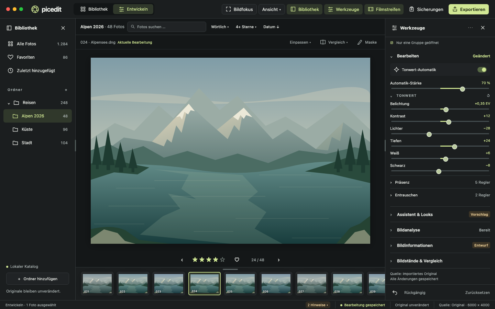
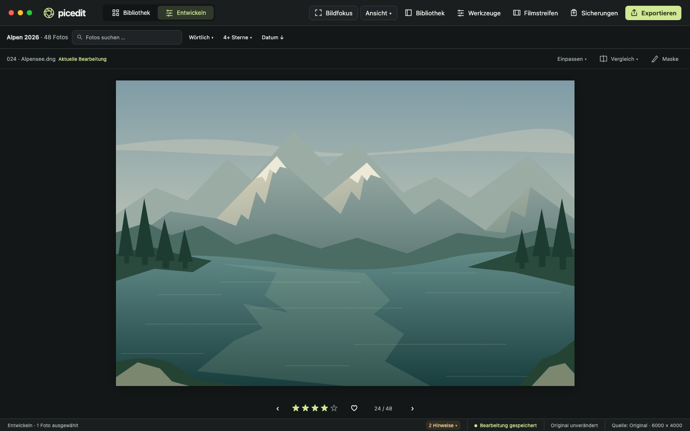
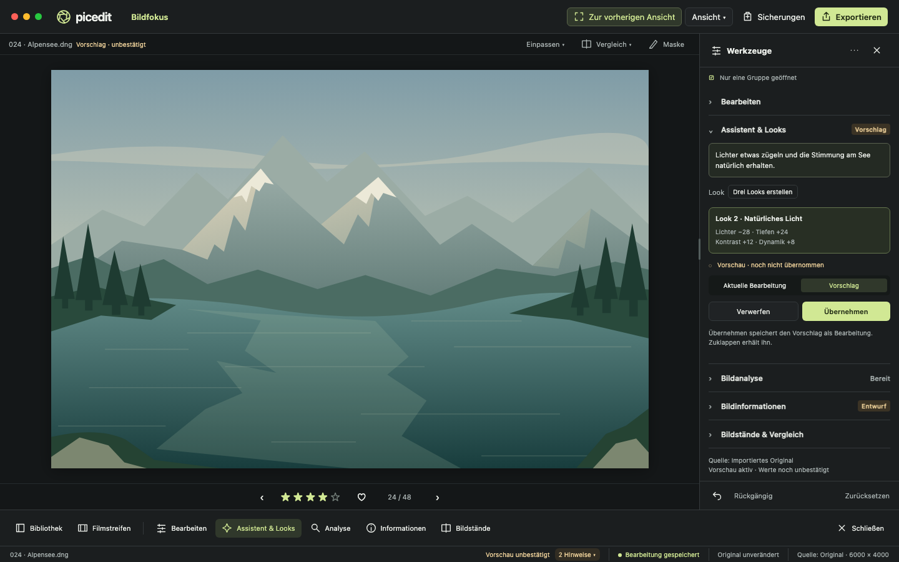
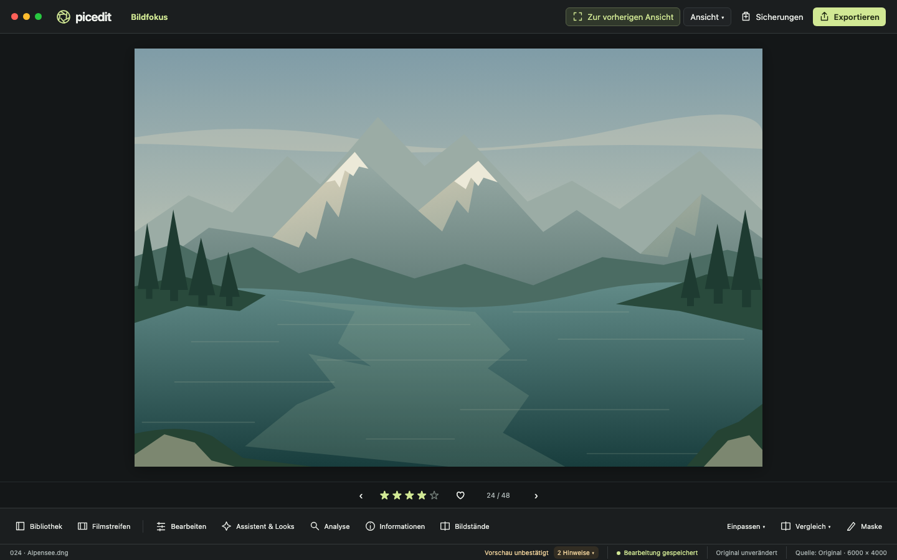

# Zwei Oberflächenentwürfe für Issue 45

17. Oktober 2026 · [Issue #45](https://github.com/dr-dimitri/picedit/issues/45) · analysierter App-Stand `fba0c9b`.

Umsetzungsstand: Der Bildfokus aus Vorschlag B ist in der Anwendung umgesetzt. Die aktuellen Bedienwege und Zustandsregeln stehen unter [Bildfokus und Arbeitsbereiche](../../WORKSPACE-LAYOUT.md). Die folgenden Bilder bleiben die ursprünglichen statischen Entwürfe.

Dies sind **statische Entwürfe zur Entscheidung über das Layout**. Zum Zeitpunkt dieser Entwürfe war die Anwendung noch nicht umgebaut. Beide Ansichten gehören zu einem Bedienkonzept und verwenden dieselben Bearbeitungszustände. Das synthetische Alpensee-Motiv, Dateinamen, Zahlen, Looktitel und Vorschlagswerte sind Beispieldaten. Die Illustration ist kein Foto und kein Ergebnis der Bildverarbeitung. Der ausgeschriebene Looktitel steht exemplarisch für einen erzeugten Vorschlag, nicht für ein neues festes Preset.

## A · Klassische Arbeitsansicht

Bibliothek links, Werkzeuge rechts, Filmstreifen unten: Die vertraute Anordnung erhält weniger Kopfzeilen und eine fachliche Gruppierung. **Bearbeiten** steht zuerst; Belichtung und die übrigen Tonwerte sind unmittelbar erreichbar. **Präsenz** und **Entrauschen** lassen sich darunter einzeln öffnen. Die gesamte Werkzeugseite und die Bibliothek können unabhängig verschwinden oder in der Breite verändert werden. Der Filmstreifen hat einen eigenen Schalter und einen Höhengriff.

Der zweite Zustand zeigt die tatsächlich für das Bild nutzbare freie Fläche. Suche, Filter und Sortierung bleiben als Bibliotheksgruppe bestehen. Vorher/Nachher-Navigation, Sterne und Favorit bleiben ohne Filmstreifen erreichbar. Die sichtbaren Schalter öffnen die Bereiche erneut; bei schmalen Fenstern werden die drei Panel-Schalter zu Symbolen mit eindeutigen Namen und Tooltips.

**Geeignet für:** Sichten und wiederholte Korrekturen, bei denen Ordner und mehrere Werkzeuge im Blick bleiben sollen. **Abwägung:** Bei 1000 × 660 ist die Bildfläche mit beiden Seitenleisten klein. Der Werkzeugbereich scrollt; ein Gruppensprung über sein `…`-Menü verhindert, dass untere Gruppen erst durch alle Regler hindurch gesucht werden müssen.

## B · Bildfokus mit Werkzeugen nach Bedarf

**Bildfokus** öffnet im normalen Fenster eine verdichtete Ansicht. Bibliothek und Filmstreifen sind anfangs verborgen. Das beschriftete Dock öffnet direkt eine der gemeinsamen Funktionsgruppen. Der Werkzeugbereich belegt eigene Breite neben dem Bild und kann geöffnet bleiben; er liegt nicht über dem Motiv. Die Abbildung zeigt **Assistent & Looks** mit Vergleich, **Übernehmen** und **Verwerfen** unmittelbar beim Vorschlag. Der Entwurf erhält auch Anweisung, Vorschau und Metadatenentwurf beim Schließen des Bereichs.

Im geschlossenen Zustand wandern Zoom, Vergleich und Maske ins Dock. Navigation, Bewertung und Favorit behalten ihren festen Platz. **Zur vorherigen Ansicht** ist oben immer sichtbar und stellt zuvor gewählte Breiten, Gruppen und Filmstreifenhöhe wieder her. Bildfokus und macOS-Vollbild sind getrennt. Bibliothek und Filmstreifen können im Fokus über das Dock einzeln zugeschaltet werden.

**Geeignet für:** Beurteilen, Vergleichen und einzelne gezielte Bearbeitungen. **Abwägung:** Ordnerwechsel benötigt bei geschlossener Bibliothek einen zusätzlichen Klick. Für längere Serien kann sie geöffnet bleiben. Das Dock hat feste Positionen; Mausbewegungen lösen keinen Layoutwechsel aus.

## Gemeinsame Zuordnung und Bedienwege

| Einstieg | Inhalt und Verhalten |
| --- | --- |
| Bibliothek | Alle Fotos, Favoriten, zuletzt hinzugefügt, Ordner. Suche, wörtlicher/semantischer Suchmodus, Bewertungsfilter und Sortierung gehören dazu. Im Fokus öffnet dieser Einstieg auch die Bibliotheks-Suchzeile. Semantische Indexarbeit bleibt über die Hinweise erreichbar. |
| Bearbeiten | Automatische Tonwerte mit Stärke, Tonwert, Präsenz, Entrauschen. Untergruppen einzeln einklappbar; Zahlenfelder, Reset und Undo/Redo bleiben erhalten. Die aktive Automatik zeigt ihren Stärkeregler in derselben Untergruppe. |
| Assistent & Looks | Anweisung, drei erzeugte Lookkarten, Auswahl, Ausgang/Vorschlag, Übernehmen/Verwerfen. Das Bild zeigt exemplarisch die ausgewählte Karte; weitere Karten werden innerhalb dieser Gruppe erreicht. |
| Bildanalyse | Bildinhalt analysieren, Analyseergebnis und dazugehörige Aktionen. Analyse ist kein bestätigter Metadatensatz und kein Look. |
| Bildinformationen | Bestätigte Angaben, manuelle Texte/Tags, KI-Entwurf und ausdrückliche Annahme. Tagaktionen **Ergänzen/Ersetzen** und Feldwahl verbleiben hier, ebenso Aufnahme-/Dateiinformationen und Metadatenimport/-export. |
| Bildstände & Vergleich | Gespeicherte Varianten und aktive Quelle. Quellenwechsel bleibt eine ausdrückliche, rückgängig machbare Bearbeitung. Der Vergleich selbst ändert die Quelle nicht. |
| Vergleich beim Bild | Menü mit **Aktuelle Bearbeitung**, **Importiertes Original** und **Aktuelle Quelle ohne Regler**. Bei Lookvorschlägen kommt deren eigener Ausgang/Vorschlag-Vergleich hinzu. Quelle und angezeigter Vorschauzustand müssen unterscheidbar bleiben. |
| Maske | Bestehender Einstieg in den Maskeneditor; keine neue Generierung oder neue Maskenfunktion. |
| Sicherungen / Exportieren | Globale, beschriftete Einstiege. JPEG-Export verwendet angenommene Werte, auch wenn das Bild einen unbestätigten Vorschlag zeigt. |

**Ansicht** enthält die unabhängigen Panel-Schalter, **Bildfokus**, **Darstellung merken** und **Standardansicht wiederherstellen**. Sichtbarkeit, Breiten, Höhe und Gruppen werden außerdem automatisch als Darstellungspräferenzen gespeichert, getrennt für Bibliothek/Entwickeln; kleinere Fenster begrenzen gespeicherte Größen. **Nur eine Gruppe geöffnet** ist optional. Im Mehrgruppenmodus bleiben mehrere Gruppen offen. Das Werkzeug-`…`-Menü bietet direkte Gruppensprünge, auch wenn Gruppen unterhalb des sichtbaren Scrollbereichs liegen.

Die globale Aktion **2 Hinweise** steht für den exemplarischen offenen Vorschlag und Metadatenentwurf. Das Menü führt jeweils mit einer Auswahl zum betroffenen Bereich. **Läuft**, **Entwurf/Vorschlag** und **Fehler** haben Namen und nicht allein eine Farbe. Bei Speicherfehlern ersetzt eine ausdrücklich beschriftete Aktion **Speicherfehler · Prüfen** den normalen Speicherstatus; sie öffnet direkt den Fehler und seine Wiederholungsaktion. Solche Zustände bleiben auch ohne Panels sichtbar. Eine laufende Speicherung wird unabhängig von der Anzeige abgeschlossen. Auf-/Zuklappen startet keine Analyse oder Übernahme.

Menübefehle und kollisionsfreie Tastenkürzel werden erst bei der Umsetzung festgelegt; vorhandene Navigation, `0…5`, `F`, `⌘I` und `⇧⌘E` müssen erhalten bleiben. Symbolschalter erhalten zugängliche Namen, Gruppen den Auf-/Zuklappzustand. Beim Verbergen eines fokussierten Inhalts wandert der Tastaturfokus zum sichtbaren Auslöser. Keine Layoutbefehle während normaler Texteingaben und keine Fokusfallen.

## Ablaufvergleich

Gedanklicher Durchgang, keine Nutzerstudie oder Zeitmessung. Start: ausgewähltes Foto in der Einzelbildansicht, oben stehende Werkzeug-Scrollposition, noch kein Vorschlag. In A sind die Panels wie im offenen Bild sichtbar und **Bearbeiten** geöffnet; in B sind sie geschlossen. Ein „Klick“ zählt ein Ziel, Text-/Wertänderungen und Systemdateidialoge werden gesondert genannt. Bestehende Scrollwege sind aus dem Code abgeleitet; Anzahl der Scrollgesten und Laufzeit wurden nicht gemessen.

| Aufgabe | Bestehende Oberfläche | A | B |
| --- | --- | --- | --- |
| Ordner wählen, 4+ Sterne filtern | 1 Ordnerklick + 2 Filterklicks; ggf. Ordnerbaum scrollen | 3 Klicks; gleicher Ordnerbaum | 4 Klicks einschließlich **Bibliothek**; bei offen gelassener Bibliothek 3 |
| Foto bewerten | 1 Sternklick, kein Scrollen | 1 | 1; ohne Filmstreifen verfügbar |
| Belichtung ändern | **Entwickeln** anklicken, danach an Assistent, Analyse, Metadaten und Bildständen vorbeiscrollen; Wert ändern | Wert unmittelbar ändern; 0 vorbereitende Klicks | **Bearbeiten**: 1 vorbereitender Klick, danach Wert ändern |
| Look prüfen und übernehmen | **Entwickeln**, **Drei Looks erstellen**, Karte, Vergleich **Vorschlag**, **Übernehmen**; bis zu Karten/Annahme scrollen | **Assistent & Looks**, Erstellen, Karte, Vergleich, Übernehmen: 5 Ziele; Inhalt ggf. innerhalb Gruppe scrollen | Gleichfalls 5 Ziele über direkten Dock-Einstieg |
| Titel/Tags bearbeiten | Im Info-Inspector öffnen und unter Vorschau/Bewertung scrollen; im Entwickeln-Inspector zusätzlich Assistent/Analyse passieren; Text ändern, ausdrücklich übernehmen | **Bildinformationen**, Text ändern, **Manuelle Angaben übernehmen**: 2 Klicks plus Eingabe | Gleichfalls 2 Klicks plus Eingabe über **Informationen** |
| Bildstand vergleichen | **Entwickeln**, Bildstände weiter unten öffnen, Stand wählen; Quellenvergleich oben schalten | Gruppe öffnen, Stand wählen, Vergleichsmenü öffnen und Vergleich wählen: 4 Ziele | Dock **Bildstände**, Stand wählen, Vergleichsmenü und Wahl: 4 Ziele |
| JPEG exportieren | **Exportieren**, Dialog **Exportieren**: 2 Klicks bei gemerktem Ziel | 2; Systemdialog/Optionen bei Bedarf zusätzlich | 2; gleicher Dialog, gespeicherter Bearbeitungsstand |

„Bildstand wählen“ und „Vergleich anzeigen“ sind absichtlich getrennte Schritte. Für den reinen Original-/Quellenvergleich genügt bei A/B das Vergleichsmenü mit einer Auswahl (2 Klicks), ohne zuerst eine Variante zu aktivieren. Der bisherige Inspector bietet dafür zwei direkte Schalter; die neue Bündelung kostet dort einen zusätzlichen Klick und hält den Vergleich am Bild erreichbar.

## Vermessene Entwurfsgeometrie

Alle Werte sind CSS-Pixel der **gerenderten Mockups**, keine Messungen der laufenden SwiftUI-App und keine Performanceversprechen. Browserfläche entspricht jeweils dem dargestellten Fensterinhalt; macOS-Menüleiste und Fensterschatten sind nicht eingerechnet. „Viewport“ ist die Canvas-Fläche vor dem inneren Sicherheitsabstand von 24 px je Seite. „Bild“ ist die mit `min(Breite/Bildbreite, Höhe/Bildhöhe)` berechnete Größe beim Einpassen ohne Beschnitt oder Verzerrung. Das sichtbare Motiv hat 3:2; Hochformat 2:3 ist eine reine Geometrieberechnung und kein gesondert gerendertes Foto.

| Fenster | Zustand | Viewport | Bild 3:2 | Bild 2:3 |
| --- | --- | --- | --- | --- |
| 1440 × 900 | A offen | 900 × 590 | 813 × 542 | 361,33 × 542 |
| 1440 × 900 | A geschlossen | 1440 × 686 | 957 × 638 | 425,33 × 638 |
| 1440 × 900 | B Werkzeug offen | 1120 × 686 | 957 × 638 | 425,33 × 638 |
| 1440 × 900 | B geschlossen | 1440 × 720 | 1008 × 672 | 448 × 672 |
| 1000 × 660 | A offen | 504 × 350 | 453 × 302 | 201,33 × 302 |
| 1000 × 660 | A geschlossen | 1000 × 446 | 597 × 398 | 265,33 × 398 |
| 1000 × 660 | B Werkzeug offen | 700 × 446 | 597 × 398 | 265,33 × 398 |
| 1000 × 660 | B geschlossen | 1000 × 480 | 648 × 432 | 288 × 432 |

Die zusätzliche Breite führt bei einem höhenbegrenzten Bild nicht automatisch zu einer größeren Bilddarstellung. Im Beispiel sind A geschlossen und B mit offenem Werkzeug deshalb gleich groß. Bei größeren Fenstern oder anderen Bildformaten ändert sich die begrenzende Kante.

Die jetzige App reserviert laut `LibraryView.swift` 218 pt links und 300 pt im Entwickeln-Inspector, laut `PhotoGridView.swift` 98 pt für den Filmstreifen. Ihre dynamischen Kopf-/Scrollhöhen wurden hier nicht live vermessen; daraus wird kein prozentualer Flächengewinn abgeleitet. Ein späterer Prototyp soll die aktuelle App und die neuen Ansichten am selben Foto einschließlich Hochformat und größerer Fenster live vergleichen.

## Dateien, Reproduktion und Prüfung

- [Editierbare Mockup-Quelle](mockups.html): mit `?design=a&state=open`, `?design=a&state=closed`, `?design=b&state=open` oder `?design=b&state=closed` öffnen. Schaltflächen dienen der Darstellung und haben noch keine App-Funktion.
- [Messdaten](layout-measurements.json) und [Renderer](render.cjs). Für die Reproduktion ein installiertes `playwright` mit Chromium verwenden: `node docs/design/issue-45/render.cjs`; außerhalb einer Projektinstallation gegebenenfalls dessen Paketverzeichnis über `NODE_PATH` setzen. Keine neue App-Abhängigkeit.
- Zusätzliche Mindestgrößen-Abbildungen: [A offen](a-open-1000.png), [A geschlossen](a-closed-1000.png), [B offen](b-open-1000.png), [B geschlossen](b-closed-1000.png).
- Der Renderer erzeugt acht PNGs, prüft horizontalen Überlauf und die Fenstergrenzen der Kopf-/Dock-Schalter und protokolliert Canvas und Einpassgeometrie. Zwei unabhängige Browserseiten arbeiten parallel; Schreiben derselben Datei und die gemeinsame Git-Veröffentlichung bleiben geordnet.
- Das finale Diff und die Bilder werden unabhängig reviewt; der nach `AGENTS.md` vorgeschriebene vollständige saubere App-Build wird auch für diese Dokumentationsänderung ausgeführt. Der Abschlussbericht im PR dokumentiert die Ergebnisse.

Offen für die UI-Umsetzung bleiben echte Interaktion, kleinere/größere Fenster mit beliebigen Fotos, Tastatur-/VoiceOver-Prüfung, Neustart/Wiederherstellung, Speicherfehler und Zustands-/Integrationstests. Insbesondere dürfen `AIAssistantSection.onDisappear` und `ImageAnalysisSection.onDisappear` beim bloßen Layoutwechsel keine gültigen Vorschläge verwerfen. Gruppenpräferenzen gehören außerhalb des mit `.id(asset.id)` neu erzeugten Entwicklungsbaums. Verfügbare Caches, Abbruch- und Speicherverträge bleiben erhalten. Diese Mockups erfüllen den Entwurfsschritt des Issues; sie schließen Issue 45 nicht ab.
