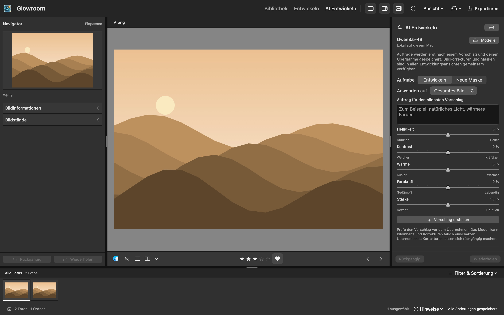
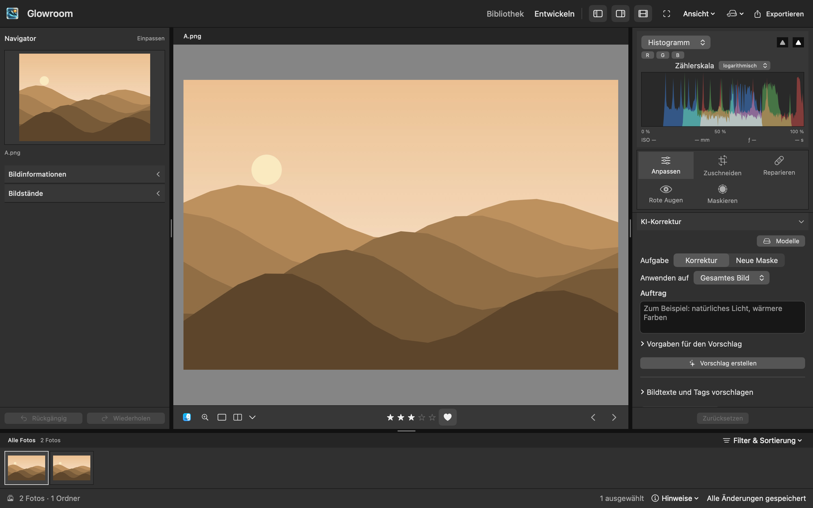
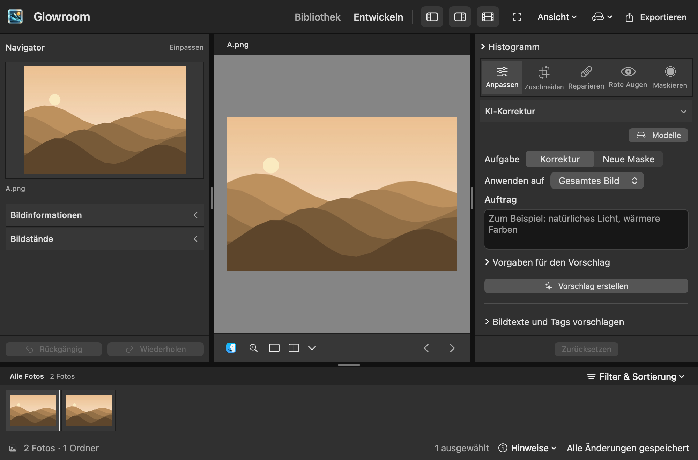

# UX-01: gemeinsames Entwickeln

Die Abnahme verwendet ein isoliertes natives SwiftUI-/AppKit-Fenster mit **demselben ausgewählten `A.png`**, neutralen Einstellungen und eingepasster Vorschau. Die gespeicherten Bildbytes stammen aus dem veröffentlichten [synthetischen Morgenlicht](synthetic-Morgenlicht.jpg), erzeugt mit `scripts/make-demo-library.swift`. Die zweite Filmstreifen-Datei enthält dieselben Bytes. Private Fotos und Benutzerkatalog werden nicht verwendet. Es findet keine Modellinferenz statt; ein lokal bereits installiertes Modell kann dennoch als verfügbar angezeigt werden.

Die Fenstergrößen sind 1440 × 900 und die unterstützte Mindestgröße 1000 × 660 **in pt**. PNG-Pixelmaße, Skalierung, Quellcommit, aktive Gruppen, Auswahl, Bildstand und SHA-256-Werte stehen neben jeder Aufnahme in JSON-Dateien. Die Testfenster liegen außerhalb des sichtbaren Desktops und aktivieren die Anwendung nicht. Die Aufnahmen zeigen tatsächliche App-Views, keine Konzeptgrafiken.

## Vorher

Alle 296 App-Quelldateien der isolierten Ausgangskopie wurden byteweise mit Commit `5511b9993cbbb7d7369a37b3c71234b496fce247` verglichen. Nur der [Testaufbau](baseline-harness.patch) wurde erweitert: öffentliches Testbild einlesen, fertig gerenderte Bildvorschau abwarten und vor der alten KI-Ansicht zusätzlich das manuelle Entwickeln aufnehmen. Der Test bestand mit einem parameterisierten Test und zwei Fällen.

| Ansicht | 1440 × 900 pt | 1000 × 660 pt |
| --- | --- | --- |
| Bisheriges Entwickeln | [Aufnahme](screenshots/before-develop-1440.png), [Metadaten](screenshots/before-develop-1440.json) | [Aufnahme](screenshots/before-develop-1000.png), [Metadaten](screenshots/before-develop-1000.json) |
| Bisheriges AI Entwickeln | [Aufnahme](screenshots/before-ai-develop-1440.png), [Metadaten](screenshots/before-ai-develop-1440.json) | [Aufnahme](screenshots/before-ai-develop-1000.png), [Metadaten](screenshots/before-ai-develop-1000.json) |



Reproduktion in einer separaten Kopie des Ausgangscommits: `baseline-harness.patch` anwenden, das veröffentlichte JPEG als `GLOWROOM_WORKSPACE_SNAPSHOT_FIXTURE` setzen und ausführen:

```sh
GLOWROOM_TEST_BUILD_PATH=/private/tmp/glowroom-193-baseline-build \
GLOWROOM_WORKSPACE_SNAPSHOTS=/private/tmp/glowroom-193-before \
GLOWROOM_WORKSPACE_SNAPSHOT_FIXTURE=/absoluter/pfad/synthetic-Morgenlicht.jpg \
./scripts/test.sh --jobs 4 \
  --filter WorkspaceProposalLifecycleTests/aiDevelopmentHasItsOwnWorkspaceAndKeepsModelManagementWithoutSelection
```

## Nachher

Der finale Screenshotlauf bestand mit einem parameterisierten Test und zwei Fällen in **17,356 s**. Die 299 zugehörigen versionierten App-, Paket- und Harnessdateien sind in [source-hashes.json](source-hashes.json) festgehalten und wurden dem Implementierungscommit `554b9c313d6424835657761b7d557c7b22fd9239` nach byteweiser Prüfung zugeordnet. Die Aufnahmezustände verwenden dieselbe neutrale Quelle wie vorher. Das normale Zoomkommando wird zwischen KI-Korrektur und Licht zusätzlich vergrößert und wieder eingepasst; Auswahl und Bearbeitungssnapshot bleiben unverändert.

| Ansicht | 1440 × 900 pt | 1000 × 660 pt |
| --- | --- | --- |
| Gemeinsames Entwickeln, KI-Korrektur | [Aufnahme](screenshots/after-develop-ai-1440.png), [Metadaten](screenshots/after-develop-ai-1440.json) | [Aufnahme](screenshots/after-develop-ai-1000.png), [Metadaten](screenshots/after-develop-ai-1000.json) |
| Dasselbe Foto, Licht | [Aufnahme](screenshots/after-develop-light-1440.png), [Metadaten](screenshots/after-develop-light-1440.json) | [Aufnahme](screenshots/after-develop-light-1000.png), [Metadaten](screenshots/after-develop-light-1000.json) |
| Bildfokus | [Aufnahme](screenshots/after-develop-focus-1440.png), [Metadaten](screenshots/after-develop-focus-1440.json) | [Aufnahme](screenshots/after-develop-focus-1000.png), [Metadaten](screenshots/after-develop-focus-1000.json) |





Alle sechs Aufnahmen wurden visuell kontrolliert. Die Kopfzeile zeigt ausschließlich Bibliothek/Entwickeln. Bei 1440 pt stehen Histogramm und Werkzeuge fest über KI-Korrektur beziehungsweise Licht. Bei 1000 × 660 pt sind **Auftrag**, **Vorschlag erstellen** und alle fünf beschrifteten Bildwerkzeuge sichtbar; im Lichtzustand stehen die sechs primären Tonwertregler bereit. Das Histogramm hat einen klar benannten Aufklappeinstieg. Der Bildfokus zeigt das unveränderte Foto mit Rückkehraktion und vollständigem Gruppendock. Es gibt keine abgeschnittenen Werkzeugnamen oder zusätzlichen kleinen Erklärabsätze in diesen Zuständen. Feldnamen, Werte und Einheiten bleiben erhalten.

Reproduktion am geprüften Implementierungsstand, nach erfolgreichem Testbuild:

```sh
GLOWROOM_WORKSPACE_SNAPSHOTS=/private/tmp/glowroom-193-after \
GLOWROOM_WORKSPACE_SNAPSHOT_FIXTURE="$PWD/docs/issue-193/synthetic-Morgenlicht.jpg" \
GLOWROOM_WORKSPACE_SNAPSHOT_COMMIT="$(git rev-parse HEAD)" \
./scripts/test.sh --jobs 4 --skip-build \
  --filter WorkspaceProposalLifecycleTests/unifiedDevelopmentKeepsPhotoAndHistoryAcrossCorrectionGroups
```

## Befunde und Korrekturen während der Abnahme

Zwei Testkompilierungen wurden während der parallelen Integration wegen gleichzeitig veränderter Quellen abgewiesen. Diese Versuche gelten nicht als erfolgreiche Prüfung. Für die abschließenden Läufe wurden die Quellen eingefroren; Screenshotlauf, weitere native Tests, Bereinigung und Release-Build werden wegen gemeinsamer Build-/UI-Ressourcen geordnet ausgeführt.

Der erste Integrationslauf machte einen verschwundenen Masken-Werkzeugschalter nach einer Quellenersetzung sichtbar. Ein bloßes längeres Warten löste das Problem nicht: die verzögert montierte Werkzeugauswahl lag im scrollenden Inhalt. Die Werkzeugauswahl steht jetzt zusammen mit dem Histogramm außerhalb des Scrollbereichs. Die Abnahme am Mindestfenster zeigte außerdem zu wenig Platz für den KI-Auftrag; dort ist das ausdrücklich aufklappbare Histogramm zunächst geschlossen, und die fünf beschrifteten Werkzeuge stehen in einer Zeile. Die unnötige kleine technische Tonwertversionszeile entfällt; die vorhandene ausdrückliche Aktion zur Aktualisierung eines alten Bildstands bleibt normal lesbar erreichbar.

Das Review fand ein zusätzliches Rückgängig-/Wiederholen-Paar in den Maskenpaletten. Im gemeinsamen Arbeitsbereich gibt es jetzt ausschließlich das Paar der linken Navigationsspalte, das dieselbe Maskenhistorie wie Menü und Tastenkürzel bedient. Selbstständig verwendete Maskenpaletten behalten ihren bisherigen lokalen Ersatz. Tests verwenden die tatsächlichen gemeinsamen Schaltflächen, prüfen leere und aktive Inline-Paletten sowie die schwebenden Werkzeuge und vergleichen danach die Masken- und Editorwerte.

## Abschließende Prüfungen

Die gezielte integrierte Prüfung bestand mit **210 Tests in 24 Suites** in **30,130 s** nach erfolgreicher Testkompilierung (**90,28 s**). Sie umfasst Workspace/Layout/Fokusrouting, native Proposal-/Masken-Lebenszyklen und gemeinsame Historie, KI-Modell-/Übernahmegrenzen, Details/Schärfen, Retusche und die betroffenen Layoutverträge. Die Standardtests benötigen keine privaten Fotos und keine echte Modellinferenz.

Reproduktion der integrierten Prüfung:

```sh
./scripts/test.sh --jobs 4 --filter 'WorkspaceLayoutTests|WorkspaceFocusRoutingTests|DevelopWorkspaceTests|WorkspaceProposalLifecycleTests|AIDevelopmentModelTests|AIDevelopmentAcceptanceTests|DevelopRepairInspectorTests|CompactMaskLayoutTests|PhotoMetadata.*Tests|SemanticLibraryTests|DevelopSharpeningWorkspaceTests'
```

Der erforderliche saubere vollständige Release-Build mit `./scripts/build-app.sh` bestand: Kompilierung in **320,56 s**, App-Paketierung und strenge Signaturprüfung erfolgreich. Vorher wurden laufende Build-/Testprozesse geprüft und die generierten Verzeichnisse `.build/`, gegebenenfalls `.build-app/` sowie `dist/Glowroom.app` bereinigt; `.build-app/` war nicht vorhanden. Die Ausführung hatte den vorgeschriebenen Netzwerkzugriff für die festgelegten Swift-Pakete. Quellen, private Testbilder und Nutzerdaten blieben erhalten. Zwei unabhängige Reviews plus Integrationsreview der finalen Schnittstellen, Tests und Dokumentation sind ohne offene Befunde abgeschlossen. Die anschließende reine Evidenz-/Metadatenänderung beeinflusst den Build nicht und benötigt keinen weiteren App-Build.

## Funktionsnachweise und Grenzen

`unifiedDevelopmentKeepsPhotoAndHistoryAcrossCorrectionGroups` prüft die tatsächlichen Gruppensprünge, den nativen Zoomschalter, erhaltene Auswahl und identischen Bearbeitungssnapshot, Fokus-Rückkehr sowie Modellverwaltung ohne Foto. Ein während der Prüfung gefundener Fehler durch die verzögerte Werkzeugmontage nach einem Quellenwechsel wurde durch die feststehende Werkzeugauswahl oberhalb des Scrollbereichs behoben. Der native Quellenwechseltest wartet auf den tatsächlich bedienbaren Maskenschalter und öffnet damit eine neue Palette mit der neuen Quelle. Derselbe Fall prüft genau ein Rückgängig-/Wiederholen-Paar bei leerer Inline-Palette, aktiver Inline-Maske und schwebenden Maskenwerkzeugen; tatsächliche Klicks auf das gemeinsame Paar stellen die erwarteten Masken- und Editorwerte wieder her. Weitere Workspace-Fälle prüfen die einzige sichtbare Zuständigkeit von Rückgängig/Wiederholen, Speicherstatus und Vergleich sowie erhaltene Maskenentwürfe und abgewiesene Quellen-/Auswahlwechsel. Modelltests prüfen Abbruch, verspätete Ergebnisse und angenommene Speicheraufträge mit kontrollierten Diensten. Die Aufnahmen allein beweisen weder Speicheratomarität noch Modellqualität.

Die visuelle Prüfung betrifft die angezeigten Hauptzustände einschließlich normal lesbarer Status-/Fehlermeldungen, Primäraktionen und Panelumschaltung. Vollständige Modellqualifizierung, der neue gerenderte Korrekturvergleich (UX-02), die fachliche Masken-/Retuschekonsolidierung und der abschließende komplette VoiceOver-Durchlauf bleiben bei ihren zugehörigen Issues. Die Oberfläche öffnet aus der neuen Navigation keine nicht implementierten Fähigkeiten.
