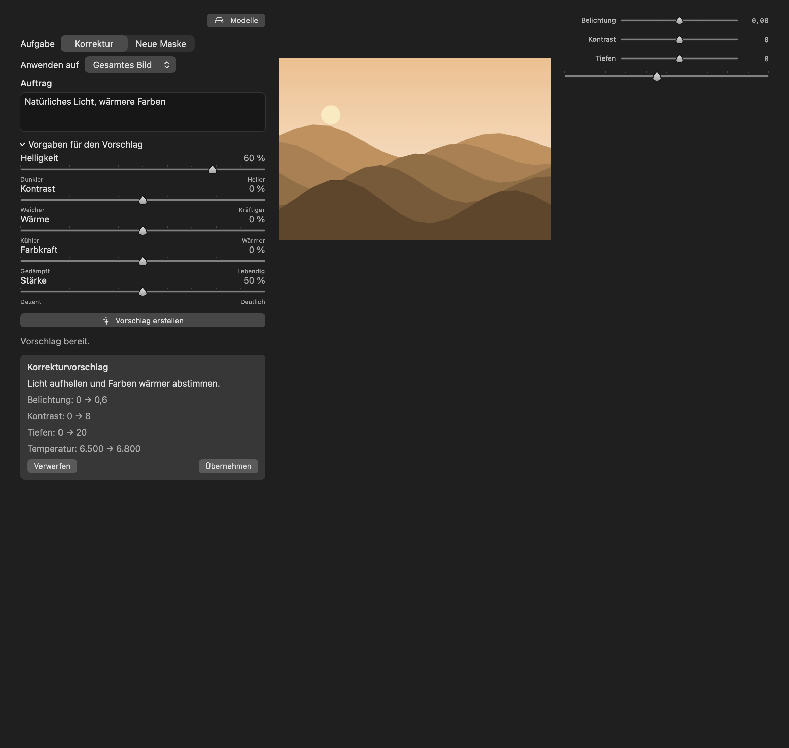
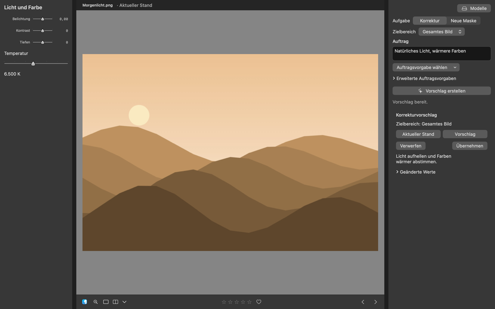
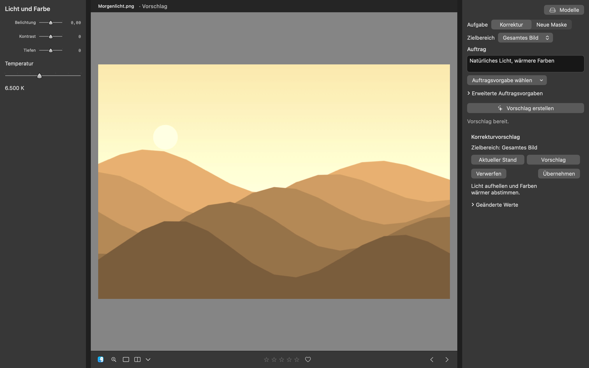
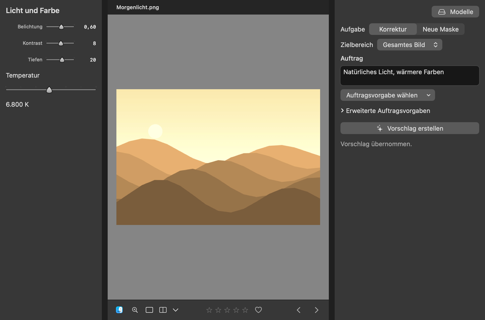

# UX-02: KI-Korrekturen am gemeinsamen Foto prüfen

Die Aufnahmen stammen aus tatsächlichen SwiftUI-/AppKit-Views in isolierten,
nicht aktivierten Testfenstern außerhalb des sichtbaren Desktops. Die Tests
verwenden eine auf 768 × 512 Pixel begrenzte ImageIO-Ableitung des bereits
veröffentlichten [synthetischen Morgenlichts](../issue-193/synthetic-Morgenlicht.jpg).
Private Fotos, Benutzerkatalog und Originaldateien werden nicht verwendet.
Die kontrollierten Modellantworten beweisen den Vorschlagsablauf und die
Render-/Speicherintegration, keine neue Qwen-Inferenz oder Modellqualität.

## Vorher

Die Ausgangskopie stammt unverändert aus Commit
`68a542293719d2334a07ee082819a8c088a81dc0`. Alle App-Quelldateien wurden byteweise
mit diesem Commit verglichen; die [SHA-256-Liste](baseline-source-hashes.json)
hält diese Zuordnung fest. Ausschließlich der [native Testaufbau](baseline-harness.patch)
wurde um Bildfixture, Auftrag, geöffnete Vorgaben, feste Fenstergröße und
Aufnahmen erweitert. Die tatsächlichen App-Farben und die dunkle native
Fensterdarstellung entsprechen der App.

Das 1160 × 1100 pt große Abnahmefenster stellt die bisherige KI-Ansicht neben
die regulären Regler und das unveränderte aktuelle Foto. Wie die Nachher-Fälle
verwendet es **Gesamtes Bild**, neutrale angenommene Ausgangswerte und dieselbe
kontrollierte Modellantwort. Die anfängliche Stärke von 50 % ergibt
Belichtung **0 → 0,6**, Kontrast **0 → 8**, Tiefen **0 → 20** und Temperatur
**6500 → 6800**. Der Ausgangsstand zeigt die bisherige Zusammenfassung mit
Wertedeltas; eine gerenderte Korrekturvorschau wurde dort nicht hinzugefügt.
Die verbindliche Bildpaarung **Aktueller Stand / Vorschlag** liegt zusätzlich
innerhalb jedes Nachher-Falls und verwendet identische Quelle, Zoom und
Bildausschnitt.

- [Auftrag mit alten Intentreglern](screenshots/before-order-intents.png), [Metadaten](screenshots/before-order-intents.json)
- [Vorhandener Vorschlag als Werteliste](screenshots/before-proposal-values.png), [Metadaten](screenshots/before-proposal-values.json)



Der finale Baselinelauf bestand mit **einem Test und drei Fällen in 4,316 s**.
Der erste Versuch mit der unbegrenzten 1600-px-Fixture scheiterte vor der
Aufnahme an der bestehenden 1024-px-Grenze von `describeRaster`; die Fixture
wird jetzt vor der temporären PNG-Erstellung auf 768 px begrenzt. Vorläufige
Aufnahmen mit transparentem Testhintergrund und unpassender nativer Darstellung
wurden bei der visuellen Prüfung verworfen und durch die oben verlinkten
Aufnahmen mit App-Farben und dunkler Fensterdarstellung ersetzt. Keine dieser
Korrekturen verändert Produktquellen.

Reproduktion in einer getrennten Kopie des Ausgangscommits, nach Anwenden des
Harness-Patches:

```sh
GLOWROOM_TEST_BUILD_PATH=/private/tmp/glowroom-194-before-build \
GLOWROOM_194_FIXTURE=/absoluter/pfad/synthetic-Morgenlicht.jpg \
GLOWROOM_194_SNAPSHOTS=/private/tmp/glowroom-194-before-screenshots \
./scripts/test.sh --jobs 4 \
  --filter AIDevelopmentAcceptanceTests/acceptanceUpdatesNativeControlsPreviewHistoryAndDurableSettings
```

## Nachher und Funktionsprüfung

`AICorrectionReviewWorkspaceTests` verwendet die tatsächliche gemeinsame
`DetailView` mit Bildkopf, eingepasstem Foto und Zoomsteuerung. Daneben stehen
der tatsächliche KI-Auftrag und die regulären nativen Belichtungs-, Kontrast-,
Tiefen- und Temperaturregler. Der Testaufbau zeigt diese Kontrollen zur Abnahme
gleichzeitig; er ersetzt weder die Produktnavigation noch die gewöhnlichen
Licht-/Farbgruppen. Die Fenstergrößen sind **1000 × 660 pt** und **1440 × 900 pt**.
Die PNGs haben bei 2-facher Skalierung **2000 × 1320 px** beziehungsweise
**2880 × 1800 px**; die Baseline hat **2320 × 2200 px**. Die zugehörigen JSONs
halten Quell-/Screenshot-SHA-256, macOS-Version und Build, Skalierung und
sichtbaren Prüfstand fest.

Der Test hält den Modellauftrag kontrolliert an, nimmt den laufenden Zustand
mit **Abbrechen** auf und liefert danach eine gültige Antwort über den üblichen
Antwort-/Renderpfad. Die Paarung **Aktueller Stand / Vorschlag** verwendet dieselbe
Quelle, denselben Zoom und denselben Bildausschnitt. Der Vorschlag wird aus der
bereits decodierten Bildbasis gerendert. Der Test betätigt die tatsächlichen
Schaltflächen, liest die regulären nativen Regler und prüft zusätzlich:

- Vor Übernahme bleiben Einstellungen, akzeptierte Vorschaupixel, Speicherstatus und Undo-Historie unverändert.
- Der sichtbare Vorschlag hat andere Pixel und dieselbe decodierte Ausgangsbasis; Ansichtswechsel starten keine weitere Inferenz.
- Übernahme aktiviert die geprüften Werte. Ein Undo stellt den gesamten Ausgangsstand wieder her; Redo und erneut geöffneter Store enthalten denselben angenommenen Stand.
- Verwerfen verändert weder angenommene Werte noch Revision. Abbruch entfernt Vorschlag und Vorschau; ein Fehler bleibt als eigener lesbarer Status sichtbar.
- Das fehlende Modell bietet eine ausdrückliche Einrichtung; Originalbytes bleiben unverändert.

Reproduktion nach erfolgreicher Testkompilierung:

```sh
GLOWROOM_194_FIXTURE="$PWD/docs/issue-193/synthetic-Morgenlicht.jpg" \
GLOWROOM_194_SNAPSHOTS=/private/tmp/glowroom-194-after \
GLOWROOM_WORKSPACE_SNAPSHOT_COMMIT="$(git rev-parse HEAD)" \
./scripts/test.sh --jobs 4 --skip-build \
  --filter AICorrectionReviewWorkspaceTests
```

Die Nachher-Aufnahmen stehen für jeden geforderten Zustand bereit:

| Zustand | 1000 × 660 pt | 1440 × 900 pt |
| --- | --- | --- |
| Leerer Auftrag mit Zielbereich | [PNG](screenshots/after-empty-1000.png), [JSON](screenshots/after-empty-1000.json) | [PNG](screenshots/after-empty-1440.png), [JSON](screenshots/after-empty-1440.json) |
| Laufender Auftrag mit Abbrechen | [PNG](screenshots/after-running-1000.png), [JSON](screenshots/after-running-1000.json) | [PNG](screenshots/after-running-1440.png), [JSON](screenshots/after-running-1440.json) |
| Aktueller Stand | [PNG](screenshots/after-current-1000.png), [JSON](screenshots/after-current-1000.json) | [PNG](screenshots/after-current-1440.png), [JSON](screenshots/after-current-1440.json) |
| Vorschlag auf derselben Bildfläche | [PNG](screenshots/after-proposal-1000.png), [JSON](screenshots/after-proposal-1000.json) | [PNG](screenshots/after-proposal-1440.png), [JSON](screenshots/after-proposal-1440.json) |
| Übernommen, mit regulären Werten | [PNG](screenshots/after-applied-1000.png), [JSON](screenshots/after-applied-1000.json) | [PNG](screenshots/after-applied-1440.png), [JSON](screenshots/after-applied-1440.json) |
| Fehlgeschlagener Auftrag | [PNG](screenshots/after-error-1000.png), [JSON](screenshots/after-error-1000.json) | [PNG](screenshots/after-error-1440.png), [JSON](screenshots/after-error-1440.json) |
| Fehlendes Modell mit Einrichtung | [PNG](screenshots/after-model-missing-1000.png), [JSON](screenshots/after-model-missing-1000.json) | [PNG](screenshots/after-model-missing-1440.png), [JSON](screenshots/after-model-missing-1440.json) |







Alle 14 finalen Nachher-Aufnahmen wurden visuell geprüft. **Auftrag**,
**Zielbereich**, Primäraktionen, Abbruch und Annahme bleiben in beiden Größen
lesbar erreichbar. Der Vorschlag ist im Bildkopf ausdrücklich gekennzeichnet;
die Bildpaarung behält Quelle und Geometrie bei. Fehler und fehlendes Modell
sind eigenständige normal große Statuszeilen mit passender Aktion. Es gibt
keine kleinen erklärenden Caption-/10-/11-pt-Absätze im betroffenen KI-Ablauf.
Die [Quellmanifestdatei](source-hashes.json) identifiziert die exakten App-,
Paket- und Harnessbytes; die JSONs nennen diesen Stand ausdrücklich als
Arbeitsstand auf Basis des Ausgangscommits.

Der erste erfolgreiche native Integrationslauf bestand mit **drei Tests in drei
Suites und sieben Parameterfällen in 9,491 s** nach **29,60 s** Testkompilierung.
Die abschließende gezielte Prüfung nach der letzten Übernahmefreigabe- und
Capture-Korrektur bestand mit **23 Tests in drei Suites in 4,900 s** nach
**30,91 s** Testkompilierung. Sie erzeugte die oben verlinkten finalen
Nachher-Aufnahmen. Die Aufnahmen und Assertions ergänzen sich: Ein Screenshot allein belegt weder
Unverändertheit der gespeicherten Werte vor der Übernahme noch einen einzelnen
Undo-Schritt. Beides wird im nativen Test sowie den Modelltests ausdrücklich
geprüft.

Ergänzend prüft `WorkspaceProposalLifecycleTests/unifiedDevelopmentKeepsPhotoAndHistoryAcrossCorrectionGroups`
die vollständige Produktnavigation mit `LibraryView`, Gruppenwechsel und
Modellzugängen. Modell-/Maskentests decken veraltete Antworten, Abbruch,
Zielmasken und schnelle Kontextwechsel ab. Der gezielte Fall
`coldAndWarmProposalsRenderFromTheSameDecodedSourceWithoutNewInferenceOnDisplayChanges`
prüft getrennt die erste und wiederholte Korrekturvorschau, dieselbe decodierte
Basis und die Wiederverwendung desselben gecachten Ausgabebildes. Das ist ein
funktionaler Cache-Nachweis, keine gemessene RAW- oder GPU-Beschleunigung. Vorschau-/Exporttests verwenden
weiterhin den angenommenen Bildstand. Objektmaskenkonsolidierung bleibt UX-03;
Modellgewichte, Antwortvalidierung und Fähigkeitsgrenzen werden nicht erweitert.

## Befunde und Korrekturen während der Integration

Die erste Testkompilierung wies einen verschachtelten optionalen Maskenpreviewwert
sowie während paralleler Integration veränderte Quellen ab. Die optionale
Rückgabe wurde korrekt abgeflacht; weitere Kompilierungen verwenden eingefrorene
Quellen. Fehlversuche zählen nicht als bestandene Prüfung.

Der erste integrierte Lauf mit 85 Tests fand fehlende native Schaltflächen in
fünf Fällen. Ein Eltern-Identifier auf dem Fortschrittscontainer hatte den
Identifier der **Abbrechen**-Schaltfläche überdeckt; dieser Produktfehler ist
behoben. Der Übernahmetest hatte außerdem `finishSaving()` zur Zwischenprüfung
eines noch offenen Vorschlags verwendet. Diese Methode signalisiert bewusst
den Abschluss des Editors und entwertet offene Vorschläge. Der Test verwendet
für den gewünschten reinen Persistenzabschluss jetzt `flush()`; die bestehende
Schließsemantik bleibt erhalten. Beide Ursachen wurden im folgenden nativen
Lauf mit tatsächlichen Schaltflächen nachgeprüft.

Die visuelle Prüfung fand die fehlende Modellsituation unmittelbar nach einer
Testfenster-Neumontage noch im Bildladezustand. Diese Aufnahme wird erst nach
bestätigter finaler Vorschau aufgenommen. Die Grenze und das Warten betreffen
den Abnahmeaufbau, keine neue Inferenz und keine geänderte Produktionsfrist.

Ein Review fand außerdem den neuen **Foto auswählen**-Einstieg nur innerhalb
der KI-Ansicht; die tatsächliche Entwickeln-Leeransicht montierte diese Ansicht
bei fehlender Auswahl nicht. Der normale Leerzustand bietet die Aktion jetzt
direkt und bleibt zusammen mit der Modellverwaltung nativ geprüft.

Ein weiteres UI-Review löste die Übernahmefreigabe von der Modellbereitschaft.
Nach erfolgreicher Inferenz und Renderprüfung braucht ein gültiger Vorschlag
keine Gewichte mehr. Die Modellprüfung sperrt neue Aufträge; **Übernehmen**
richtet sich nach gültigem Bild-/Bearbeitungskontext und Schreibfreigabe.
Ein nativer Regressionstest prüft diese Grenze.

## Vollständige Prüfung und sauberer App-Build

Ein gemeinsamer vollständiger Prozesslauf mit **1946 Tests in 263 Suites**
endete nach **80,165 s** mit **58 Prüfproblemen**. Darunter waren zahlreiche
noch nicht abgeschlossene Editor-/Bibliotheks-Fixtures beim Hangwächter sowie
native Animations-/Ereignisprüfungen unter derselben Last. Dieser Lauf gilt
nicht als erfolgreich. Für den vollständigen Abschluss wird der bestehende
`scripts/test-isolated.py`-Runner mit dem gesamten vom SDK entdeckten Katalog
verwendet. Er trennt die gemeinsam veränderlichen AppKit-Prozessressourcen;
fachliche Assertions und Produktionsfristen werden nicht abgeschwächt.
Das Ergebnis wird zusammen mit der SDK-Katalogzuordnung und den Prozesslogs
in seinem `summary.json` festgehalten.

Ein sauberer vollständiger App-Build ist erforderlich, weil Oberfläche,
Vorschauintegration und Vorschlagslebenszyklus das Laufzeitverhalten ändern.
Der Release-Build verwendet ausdrücklich den frischen Pfad
`GLOWROOM_BUILD_PATH=/private/tmp/glowroom-194-release-build` und
`GLOWROOM_BUILD_JOBS=3`. Vor dem Start wurden laufende Prozesse und die
verwendeten Pfade geprüft, der neue Release-Pfad sowie das alte
`dist/Glowroom.app` bereinigt. `.build-app/` war nicht vorhanden. `.build/`
bleibt währenddessen erhalten, weil der vollständige isolierte Testlauf diesen
Pfad aktiv verwendet; es werden keine aktiven Build-Locks entfernt.
Release-Kompilierung und Tests haben getrennte veränderliche Buildverzeichnisse.
Die Parallelität bleibt begrenzt: zwei Release-Compilerjobs plus Icon-Auftrag
neben jeweils einem isolierten Testprozess. Quellen und lokale Originalfotos
bleiben unberührt. Der Build hat den vorgeschriebenen Netzwerkzugriff für die
festgelegten Swift-Pakete.

## Parallelität und Prüfgrenzen

Implementierung, Testaufbau und Dokumentation werden in getrennten
Dateiverantwortungen parallel bearbeitet. Die Baseline verwendet eigene
Quell- und Buildverzeichnisse. Abhängige Quellenprüfung, Annahme und
Undo-/Speichertransaktion bleiben geordnet. Die vorhandenen begrenzten
Vorschau-Worker und Caches werden wiederverwendet. Die kleine Wahl zwischen
zwei bereits vorliegenden Bildern benötigt keine zusätzliche Hintergrundarbeit.
Es werden keine Leistungsgewinne und keine neue Modellqualität behauptet.

Die Standardfälle verwenden synthetische Bilder und kontrollierte Dienste.
Ein Foto-/RAW-Produkttest oder ein echter Modellqualitätsnachweis wird durch
Screenshots und diese deterministischen Tests nicht ersetzt. Die sieben
privaten lokalen Testbilder bleiben unverändert und außerhalb von Git.

Der saubere vollständige Release-Build ist erfolgreich abgeschlossen:
SwiftPM-Kompilierung **465,59 s**, App-Paketierung, Info.plist-Prüfung,
ad-hoc Signierung und strenge Signaturprüfung bestanden. Das Ergebnis liegt
unter `dist/Glowroom.app`; das lokale Log ist
`/private/tmp/glowroom-194-clean-build.log`. Zwei unabhängige Code-Reviews und
das Integrationsreview einschließlich Quellen-/Cachebindung, Schnittstellen,
Tests, Bedienungsdokumentation und Screenshotmanifest sind ohne offene
Produktbefunde abgeschlossen. Nach dem Build vorgenommene reine
Dokumentations- und Testharnesskorrekturen ändern weder Kompilierung noch
Paketierung oder Laufzeitverhalten der App und erfordern keinen weiteren
App-Build.

Der isolierte Gesamtlauf prüfte **1947 SDK-Testfunktionen in 263 Suites**
in 201 getrennten Prozesspaketen. **200 Pakete bestanden**. Das verbliebene
Paket `DevelopDetailWorkspaceIntegrationTests` machte zwei bereits im
unveränderten Ausgangsstand reproduzierbare Aufnahmefehler sichtbar:
Der mittlere Messpunkt der 260-pt-Lupe lag bei 130 pt, ihr sichtbarer
Scrollausschnitt endete bei 129 pt. Der Test hatte deshalb den Hintergrund
statt der Fotopixel verglichen. Der Abnahmeaufbau scrollt jetzt die tatsächliche
Lupe sichtbar und verlangt ausdrücklich einen sichtbaren Messpunkt. Die
ursprüngliche Anforderung von mehr als 0,4 Unterschied zwischen den gewählten
Bildregionen bleibt erhalten. Ein weiterer Fall wartete nach dem Rückweg vom
Originalvergleich noch nicht auf die endgültige Bildbasis; deren späterer
Dimensionswechsel bricht eine zuvor gestartete Zeigersitzung korrekt ab.
Der Test startet die Sitzung jetzt erst nach bestätigter finaler Vorschau.

Die unveränderte Baseline reproduzierte die beiden Pixelbefunde mit exakt
denselben Hintergrundwerten; der Vergleichsfall bestand dort. Die drei
korrigierten Fälle bestanden anschließend gezielt in **4,283 s**. Die vollständige
Detail-Suite bestand danach mit **12 Tests in 20,301 s**. Dies sind private
Testharnesskorrekturen; Appquellen, Bildverarbeitung, Abbruchsemantik,
Produktionsfristen und Pixelanforderungen ändern sich dadurch nicht.
Die übrigen 200 erfolgreich geprüften Prozesspakete verwenden keine dieser
privaten Hilfsfunktionen und benötigen deshalb keinen erneuten Lauf.

Die abschließende serielle XML-Nachprüfung der Detail-Suite bestand am finalen
Teststand in **20,060 s**. Der ursprüngliche `validate_batch`-Validator des
isolierten Runners bestätigt ihre exakt **12 vorgesehenen Katalogfunktionen**.
Damit sind zusammen mit den unveränderten 200 bestandenen Prozesspaketen alle
**1947 SDK-Testfunktionen** verifiziert; **33 optionale Modell-, RAW-, Last-,
Benchmark- oder Child-Einstiege** bleiben im Standardkatalog übersprungen.
Der vom korrigierten Aufnahmehelfer ebenfalls betroffene optionale
Detail-Workspace-Benchmark wurde ausdrücklich ausgeführt und bestand zusätzlich
in **1,305 s**, einschließlich seiner unveränderten Pixelkontrollen.
Daraus wird kein Leistungsgewinn der KI-Korrektur abgeleitet.
Der [maschinenlesbare Prüfbericht](test-results.json) bewahrt den ursprünglichen
fehlgeschlagenen Paketstatus sowie die erfolgreiche gezielte Nachprüfung
getrennt. Das [Quellmanifest](source-hashes.json) umfasst abschließend 311
App-, Paket- und zugehörige Prüf-/Harnessdateien. Auch das Review des korrigierten
privaten Aufnahmehelfers und der Dokumentation ist ohne offene Befunde beendet.
