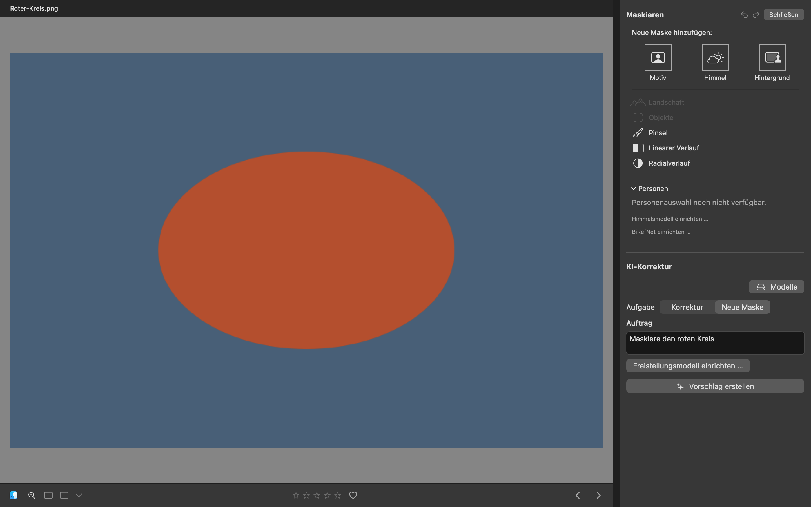
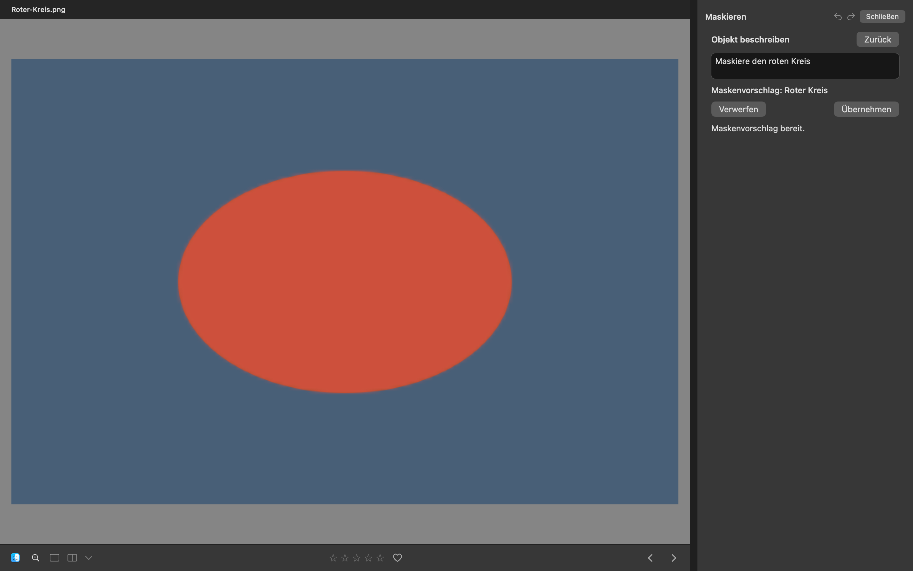
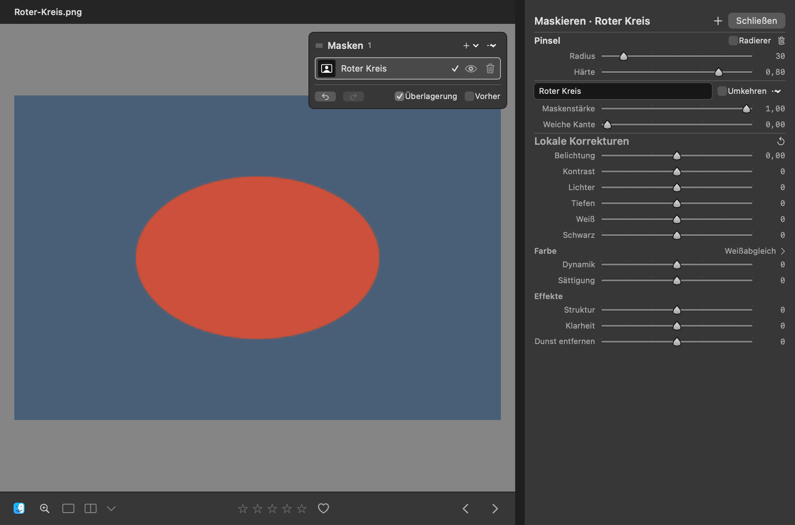

# UX-03: gemeinsame Maskenerstellung

**Maskieren** bündelt automatische und manuelle Masken. **Objekt beschreiben**
verwendet den vorhandenen Qwen-/BiRefNet-Pfad, zeigt dessen Auswahl vor der
Annahme auf dem gemeinsamen Foto und übernimmt genau eine benannte Maske in
die vorhandene Maskenhistorie. Der zweite Einstieg **Neue Maske** in
KI-Korrektur entfällt. Bedienung und technische Grenzen stehen in
[Masken bearbeiten](../MASK-EDITING.md), [Automatische Masken](../AUTOMATIC-MASKS.md)
und [KI-Korrektur](../AI-DEVELOPMENT.md).

## Aufnahmeaufbau

Die Aufnahmen verwenden tatsächliche SwiftUI-/AppKit-Views in isolierten,
nicht aktivierten Testfenstern. Ein synthetisches PNG mit 768 × 512 Pixeln
zeigt eine rote Ellipse auf blauem Hintergrund. Vorher und Nachher verwenden
dieselben Bildbytes, denselben Gegenstand und die unveränderte eingepasste
Ansicht. Private Testbilder, Benutzerkatalog und Originalfotos werden nicht
verwendet.

Die Nachher-Fälle montieren die tatsächliche `DetailView` samt Bildkopf,
Foto und Maskenüberlagerung neben `InlineMaskInspector`. Die rechte Spalte ist
340 pt breit. Die Fenstergrößen sind 1000 × 660 und 1440 × 900 pt. Dieser
Aufbau zeigt die betroffenen Produktansichten und ihre Aktionen zusammen;
er ersetzt keine zusätzliche Prüfung der vollständigen Produktnavigation.

Die Modellantwort ist kontrolliert und enthält ein nicht rechteckiges
Gray8-Raster mit abgestuften Randpixeln. Der normale Overlayworker zeichnet
daraus dieselbe Auswahl, die nach **Übernehmen** gespeichert wird. Es findet
keine echte Qwen-/BiRefNet-Inferenz statt. Damit belegen die Tests den
Vorschlags-, Quellen-, Anzeige- und Übernahmeablauf, keine neue Modellqualität.
Die nebenliegenden JSON-Dateien halten Quelle, Zustand, Fenstermaße, Quell-
und Screenshot-SHA-256 sowie die macOS-Version fest.

## Vorher

Die isolierte Ausgangskopie stammt aus dem unveränderten `main`-Stand
`433ead6e0381e48b6256c32aa893686846592f83`. Die [Dateiinventur](baseline-source-hashes.json) prüft alle App-/Paketdateien
byteweise gegen diesen Commit. Nur der [Testaufbau](baseline-harness.patch)
wurde für die Aufnahmen ergänzt. `InlineMaskInspector` zeigt den deaktivierten Eintrag
**Objekte**; `AIDevelopmentView` zeigt separat die frühere Aufgabe **Neue Maske**.
Das Foto und die eingepasste Ansicht entsprechen den Nachher-Fällen.

[Vorher-Aufnahme](screenshots/before-separated-1440.png) ·
[Metadaten](screenshots/before-separated-1440.json)



Der Baselinelauf bestand mit einem Test in **1,111 s** nach **305,84 s**
Testkompilierung. Die Aufnahme wurde visuell geprüft; beide getrennten
Einstiege und das vollständig geladene Foto sind lesbar sichtbar. Sie hat
2880 × 1800 Pixel bei zweifacher Skalierung. Das isolierte Testfenster lief
unter macOS 27.0.1 (Build 26A434).

Reproduktion in einer getrennten Kopie des Ausgangscommits nach Anwenden des
oben verlinkten Harness-Patches:

```sh
GLOWROOM_TEST_BUILD_PATH=/private/tmp/glowroom-195-baseline-build \
GLOWROOM_195_SNAPSHOTS=/private/tmp/glowroom-195-before \
./scripts/test.sh --jobs 3 --filter UnifiedObjectMaskBaselineTests
```


## Nachher

`UnifiedObjectMaskAcceptanceTests` bedient die tatsächlichen nativen
Schaltflächen **Objekt beschreiben**, **Objekt auswählen**, **Verwerfen** und
**Übernehmen**. Vor Annahme bleiben gespeicherte Einstellungen, Revision,
angenommene Bildwerte und Historie unverändert. Das gerenderte Raster enthält
volle Deckung, leere Außenbereiche und echte Teildeckung; eine gefüllte
Objektbox wäre kein gleichwertiger Nachweis.

Nach Annahme sind die benannte Maskenliste, **Umkehren**, **Maskenstärke**,
**Weiche Kante**, Pinsel/Radierer und lokale Korrekturen erreichbar. Ein
Pinselstrich ist ein weiterer eigener Undo-Schritt. Undo entfernt zuerst den
Strich und danach die Maske; Redo stellt dieselbe Maske wieder her. Die nach
`flush()` erneut geöffnete Speicherung enthält dasselbe Raster und dieselbe ID.
Fehlendes KI- beziehungsweise Motivmodell erhält den jeweils passenden
Einrichtungszugang. Die ursprünglichen PNG-Bytes bleiben unverändert.

Reproduktion nach erfolgreicher Testkompilierung:

```sh
GLOWROOM_195_SNAPSHOTS=/private/tmp/glowroom-195-after \
GLOWROOM_WORKSPACE_SNAPSHOT_COMMIT="$(git rev-parse HEAD)" \
./scripts/test.sh --jobs 4 --skip-build \
  --filter UnifiedObjectMaskAcceptanceTests
```

Der erste native Abnahmelauf bestand mit **acht Tests in zwei Suites in
10,258 s**, einschließlich beider Fenstergrößen. Nach der abschließenden
Quellen-Neuladung bestand die Objekt-Workspace-Suite erneut mit **sieben Tests
in 0,322 s**. Der finale Aufnahmelauf bestand nach **22,71 s** Testkompilierung
mit **einem Test und zwei Fensterfällen in 11,431 s**. Die 14 Hauptaufnahmen haben bei
zweifacher Skalierung 2000 × 1320 beziehungsweise 2880 × 1800 Pixel. Die vier
Einrichtungsaufnahmen zeigen dieselbe tatsächliche Produktionsansicht in
einem separaten nativen Testfenster mit den zuvor gemessenen Sheet-Maßen,
ausdrücklichem Systemfensterhintergrund und dunklem Farbschema. Zuvor bestätigt
der Test den echten Einrichtungsaufruf und die Modellbereitschaft im Sheet und
schließt es wieder. Dieser Aufnahmeweg umgeht ausschließlich die fehlerhafte
transparente Offscreen-Zwischenspeicherung des Sheets. Die JSONs dokumentieren
den Aufnahmeweg und dessen Maße. Alle Hauptaufnahmen
verwenden denselben Quell-SHA-256 wie die Baseline:
`fcd4cea33e295e6efe6ad533d3b1261a3737acea4bea44e4197628fe0d39c5ec`.

Die fehlenden Modelle werden kontrolliert simuliert. Die zugehörigen Aktionen
öffnen danach die tatsächlichen lokalen Einrichtungsdialoge. Dort kann eine
bereits auf diesem Mac vorhandene Installation als bereit angezeigt werden;
Tests entfernen keine persönliche Installation und starten keinen Download.

| Zustand | 1000 × 660 pt | 1440 × 900 pt |
| --- | --- | --- |
| Gemeinsamer Ersteller | [PNG](screenshots/after-creator-1000.png), [JSON](screenshots/after-creator-1000.json) | [PNG](screenshots/after-creator-1440.png), [JSON](screenshots/after-creator-1440.json) |
| Objektauftrag | [PNG](screenshots/after-order-1000.png), [JSON](screenshots/after-order-1000.json) | [PNG](screenshots/after-order-1440.png), [JSON](screenshots/after-order-1440.json) |
| Laufende Auswahl mit Abbrechen | [PNG](screenshots/after-running-1000.png), [JSON](screenshots/after-running-1000.json) | [PNG](screenshots/after-running-1440.png), [JSON](screenshots/after-running-1440.json) |
| Überlagerter Vorschlag vor Annahme | [PNG](screenshots/after-proposal-1000.png), [JSON](screenshots/after-proposal-1000.json) | [PNG](screenshots/after-proposal-1440.png), [JSON](screenshots/after-proposal-1440.json) |
| Angenommene Maske mit Pinsel und lokalen Korrekturen | [PNG](screenshots/after-applied-1000.png), [JSON](screenshots/after-applied-1000.json) | [PNG](screenshots/after-applied-1440.png), [JSON](screenshots/after-applied-1440.json) |
| Fehlendes KI-Modell mit Aktion | [PNG](screenshots/after-model-missing-language-1000.png), [JSON](screenshots/after-model-missing-language-1000.json) | [PNG](screenshots/after-model-missing-language-1440.png), [JSON](screenshots/after-model-missing-language-1440.json) |
| Fehlendes Motivmodell mit Aktion | [PNG](screenshots/after-model-missing-subject-1000.png), [JSON](screenshots/after-model-missing-subject-1000.json) | [PNG](screenshots/after-model-missing-subject-1440.png), [JSON](screenshots/after-model-missing-subject-1440.json) |
| Gezielte KI-Modelleinrichtung | [PNG](screenshots/after-model-setup-language-1000.png), [JSON](screenshots/after-model-setup-language-1000.json) | [PNG](screenshots/after-model-setup-language-1440.png), [JSON](screenshots/after-model-setup-language-1440.json) |
| Gezielte Motivmodelleinrichtung | [PNG](screenshots/after-model-setup-subject-1000.png), [JSON](screenshots/after-model-setup-subject-1000.json) | [PNG](screenshots/after-model-setup-subject-1440.png), [JSON](screenshots/after-model-setup-subject-1440.json) |





Die erste visuelle Prüfung wies die Einrichtungsaufnahmen zurück: Ein
transparenter Aufnahmehintergrund machte helle native Bedienelemente unlesbar,
und das Motiv-Setup befand sich noch in der Prüfung. Der Aufnahmetest wartet
nun auf einen abschließenden Modellzustand. Der anschließend verwendete
native Ersatzhost enthält dieselbe Produktionsansicht und einen ausdrücklichen
Systemfensterhintergrund. Dies ändert ausschließlich den Abnahmeaufbau.
Alle 18 Nachher-Aufnahmen wurden visuell kontrolliert. Objektauftrag,
Vorschlagsstatus, Annahme/Verwerfen, aktive Maske, Pinsel/Radierer und lokale
Korrekturen bleiben lesbar; neue Status- und Einrichtungsaktionen sind mindestens
13 pt groß. Es gibt keine kleinen erklärenden Caption-/10-/11-pt-Absätze in
den betroffenen Erstellungs- und Vorschlagsansichten. Die [Dateiinventur](source-hashes.json)
hält 309 finale App-, Paket- und zugehörige Harnessdateien fest. Die Aufnahmen
kennzeichnen diesen Stand ausdrücklich als Arbeitsstand auf Basis von
`433ead6e0381e48b6256c32aa893686846592f83`.

## Quellenbindung, Abbruch und Grenzen

`InlineObjectMaskWorkspaceTests` und die Inline-Workspace-Regressionen prüfen
veraltete Antworten, Abbruch, schnellen Foto-/Quellenwechsel, Werkzeugwechsel,
zwischenzeitliche Bearbeitungen, Undo/Redo, genaue einmalige Annahme und
Masken-/Speichergrenzen. Die Annahme prüft die native Quelle erneut im
Hintergrund. Bei extern veränderten Quellen sind **Foto neu laden** und
**Ordner aktualisieren** direkt am lesbaren Fehler erreichbar. Die Neuladung
aktualisiert Foto und Maskencanvas gemeinsam, auch bei einer extern
ersetzten Datei mit unverändertem öffentlichen Änderungsdatum. Angenommene
Masken und Historie bleiben dabei erhalten. Eine bereits laufende native
Inferenz hält ihre bestehende Ressourcenzulassung bis zur Rückkehr; Abbruch macht ihr Ergebnis sofort ungültig.

Der vorhandene `AIObjectMaskService` und seine Projektionsprüfungen bleiben
maßgeblich für die volle Quellgeometrie, das echte Segmentierungsraster und
fehlende beziehungsweise ungültige Modellantworten. `InlineMaskCanvasInputTests`
prüft weiterhin die native Eingabe, Maskenwechsel und Unterbrechungen.
Die 16-Masken-Grenze und die bestehenden Raster-/Snapshotbudgets gelten für
Objektmasken unverändert.

## Gezielte Integrationsprüfung

Die integrierte Prüfung bestand mit **117 Tests in 13 Suites in 47,877 s**.
Sie umfasst Maskensitzungen, native Canvas-Eingabe, Objektservice und
Quellgeometrie, Vorschlagsbindung, lokale Maskenhistorie und deren Budget,
kompakte Anordnung sowie den gemeinsamen Workspace-Lebenszyklus.
Vier optionale Einstiege bleiben im Standardlauf übersprungen: drei echte
Modell-/Fotoproben und der separate Canvas-Child-Einstieg. Die native
Standardabnahme verwendet kontrollierte Dienste und keine Modellinferenz.

```sh
./scripts/test.sh --jobs 4 --filter 'InlineMaskWorkspaceTests|InlineObjectMaskWorkspaceTests|AIDevelopmentMaskInputTests|AIObjectMaskServiceTests|InlineMaskCanvasInputTests|LocalAdjustmentEditorModelTests|CompactMaskLayoutTests|AIDevelopmentModelTests|WorkspaceProposalLifecycleTests|LocalAdjustmentTests|EditingHistoryBudgetTests'
```

Die ergänzende Prüfung bestand mit **48 Tests in neun Suites in 8,385 s**.
Sie umfasst native KI-Übernahme und Korrekturvergleich, Palettenlayout,
Maskenrendering, automatische Masken und Modelleinrichtung, Pinselmodell,
Compositing und Overlaymodell:

```sh
./scripts/test.sh --jobs 4 --skip-build --filter 'AIDevelopmentAcceptanceTests|AICorrectionReviewWorkspaceTests|InlineMaskPaletteLayoutTests|LocalAdjustmentRendererTests|AutomaticMaskTests|MaskEditingModelTests|MaskCompositorTests|LocalMaskOverlayModelTests|AutomaticMaskModelStoreTests'
```

Die danach ergänzte Neuladung der Foto- und Maskenbasis wurde separat mit den
sieben Objekt-Workspace-Tests geprüft. Der native Aufnahmelauf kompiliert den
abschließenden Stand und prüft beide Fenstergrößen einschließlich der
Einrichtungsdialoge erneut. Bereits bestandene unabhängige Prüfungen werden
nicht ohne Anlass wiederholt.

## Review und Parallelität

Implementierung, native Testaufbauten und Dokumentation wurden mit getrennten
Dateiverantwortungen parallel bearbeitet. Modelllokalisierung und Segmentierung
bleiben abhängig und nacheinander in der gemeinsamen Inferenzzulassung;
Quellenprüfung, Annahme, Historie und Speicherung bleiben korrekt geordnet.
Es wird kein zusätzlicher unbeschränkter Workerpool eingeführt und kein
Leistungsgewinn behauptet.

Das Integrationsreview fand einen Darstellungsfehler: Ein zuvor aktiver
**Vorher**-Vergleich oder eine ausgeblendete Überlagerung konnte den neuen
Objektvorschlag verbergen. Der Objektauftrag schaltet deshalb ausdrücklich
auf den aktuellen Bildstand mit sichtbarer Überlagerung. Die gemeinsame
Eingabe-/Statussperre berücksichtigt sowohl automatische Maskenerkennung als
auch Objektaufträge. Modellinformationen des Motiv-Setups wurden in eine
normal große, ausdrücklich geöffnete **Hilfe** verschoben; Status und Aktionen
bleiben mindestens 13 pt groß.

Der erste integrierte Testlauf mit 102 Tests in elf Suites scheiterte an drei
Prüfproblemen. Die neue lokale Kennzeichnung erhöhte die Pinselpalette im
300-pt-Inspektor auf 468 pt statt der geforderten höchstens 460 pt. Die aktive
Maske steht deshalb jetzt in der vorhandenen Kopfzeile; die Kennzeichnung der
lokalen Korrekturen ersetzt eine vorhandene Gruppenbeschriftung. Zusätzliche
Hinweiszeilen entfallen, und die unveränderte Platzgrenze bleibt verbindlich.

Der andere Befund betraf die bestehende Historie: Nach Undo einer zweiten
Maskenerstellung stellte Redo deren Raster wieder her, ließ aber die erste
Maske aktiv. Ein anschließender Pinselstrich traf damit die falsche Auswahl.
Die begrenzte Historie speichert und restauriert nun die aktive Masken-ID
zusammen mit den Ebenen. Ihr Speicherbudget rechnet die zusätzliche ID an;
Annahme und Pinselstrich bleiben getrennte Undo-Schritte. Die neuen Assertions
für dieselbe aktive Maske nach Redo und nach dem Pinsel-Undo bleiben erhalten.

Der anschließende Lauf mit 117 Tests in 13 Suites fand fünf bestehende
Overlay-Assertions verletzt: Die neue Auswahlrestaurierung veröffentlichte
auch unveränderte IDs und blendete dadurch nach einem reinen Korrektur-Undo
die rote Fläche wieder ein. Die Restaurierung weist die ID nun ausschließlich
bei einer tatsächlichen Auswahländerung zu. Die Prüfungen für automatische
Ausblendung und unveränderte Gestengruppierung bleiben unverändert streng.
Diese Korrektur entstand, während der saubere Release-Build noch ausschließlich
unveränderte Abhängigkeiten kompilierte; die Appquellen werden anschließend
vollständig aus dem finalen Stand gebaut.

Ein sauberer vollständiger App-Build ist erforderlich, weil Oberfläche,
Maskensitzung und Übernahmeablauf das Laufzeitverhalten ändern. Nach Prüfung
laufender Prozesse wurden der neue Release-Pfad
`/private/tmp/glowroom-195-release-build` und das bisherige `dist/Glowroom.app`
bereinigt; `.build-app/` war nicht vorhanden. Das Wurzelverzeichnis `.build/`
blieb erhalten, weil die gezielten Tests es aktiv verwenden. Die isolierte
Baseline verwendet ausschließlich ihr eigenes `.build/` unter
`/private/tmp/glowroom-195-baseline`. Aktive Locks, Quellen und Nutzerdaten
wurden nicht entfernt.

Der Release-Aufruf verwendet den frischen Buildpfad und den vorgeschriebenen
Netzwerkzugriff zum Laden der festgelegten Swift-Pakete:

```sh
GLOWROOM_BUILD_PATH=/private/tmp/glowroom-195-release-build \
GLOWROOM_BUILD_JOBS=3 ./scripts/build-app.sh
```

Das lokale Buildlog liegt unter `/private/tmp/glowroom-195-clean-build.log`.
Eine erste Testkompilierung scheiterte an während paralleler Integration noch
veränderten Appquellen; sie gilt nicht als erfolgreiche Prüfung.
Der erste Release-Build wurde nach den genannten Testbefunden bewusst
abgebrochen; er gilt ebenfalls nicht als bestandener Build. Nach bestätigtem
Ende aller zu diesem Build gehörenden Prozesse wurden ausschließlich dessen
veralteter eigener Lock, temporäre Ergebnisse und Release-Verzeichnis
bereinigt. Der anschließende vollständige Build startete erneut sauber. Sein
Vorgängerlog bleibt unter `/private/tmp/glowroom-195-interrupted-build.log`
erhalten.

Der saubere vollständige Release-Build ist **erfolgreich** abgeschlossen:
SwiftPM-Kompilierung **466,51 s**, App-Paketierung, Info.plist-Prüfung,
ad-hoc Signierung und strenge Signaturprüfung bestanden. Das Ergebnis liegt
unter `dist/Glowroom.app`. Die endgültigen Appquellen einschließlich der
Quellen-Neuladung wurden nach den unveränderten Abhängigkeiten aus dem
finalen Stand kompiliert. Spätere reine Testharness-, Aufnahme- und
Dokumentationskorrekturen verändern die App nicht und erfordern keinen
weiteren App-Build.
