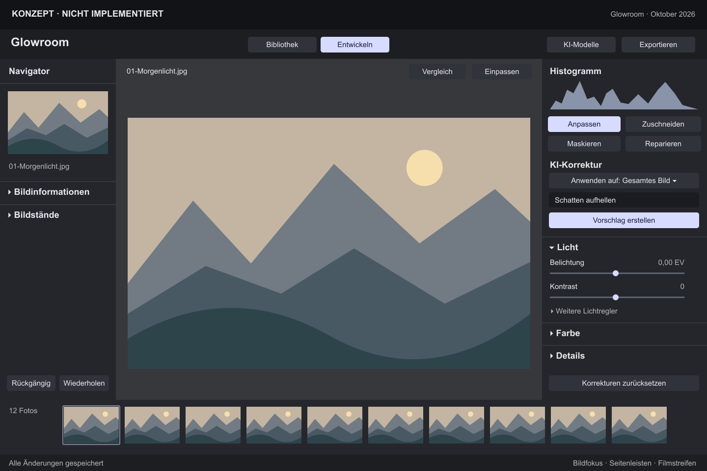
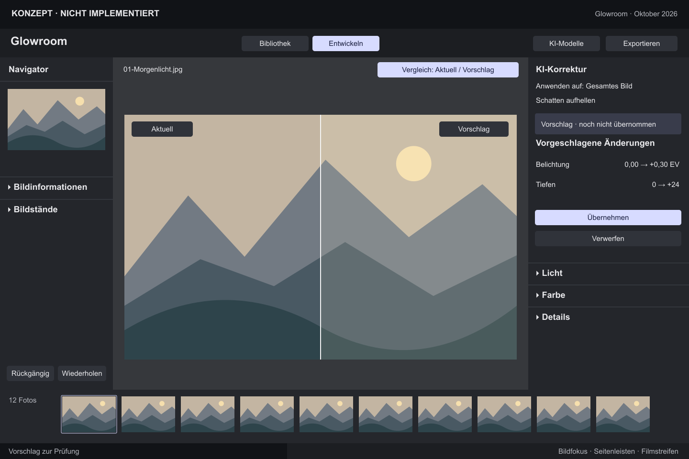
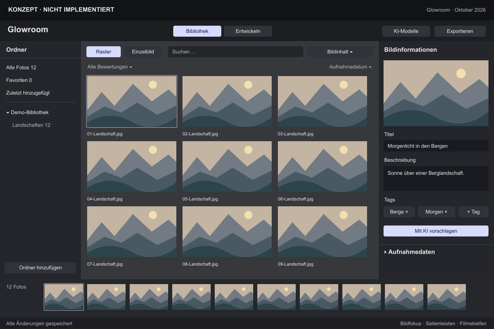

# Glowroom: ein gemeinsamer Entwicklungsbereich mit KI-Unterstützung

**Status: UX-01 umgesetzt; weitere fachliche Konzepte offen.** Die gemeinsame Entwickeln-Navigation aus [Issue #193](https://github.com/dr-dimitri/glowroom/issues/193) verwendet jetzt KI-Korrektur, Licht, Farbe und Details in einem Inspector. [Native Vorher-/Nachher-Abnahme](../issue-193/README.md). Die folgenden Konzeptgrafiken beschreiben weiterhin das übergeordnete Ziel einschließlich noch offener UX-02 bis UX-08. Die ursprüngliche Analyse stammt vom 24.10.2026, Quellcommit `c11089624d0b56cd1eabc2280e89d21d16f022f6`.

Ziel ist eine Oberfläche, in der der Anwender eine fotografische Aufgabe auswählt und die passende manuelle oder KI-gestützte Funktion dort findet. Die vom Nutzer bereitgestellten Lightroom-Classic-Bilder dienen als Referenz für große Bildfläche, seitliche Funktionsgruppen, Histogramm, Bibliotheksraster und Filmstreifen. Die privaten Referenzaufnahmen werden nicht im Repository veröffentlicht. Lightroom-Funktionen, die Glowroom nicht besitzt, sind kein Bestandteil dieses Konzepts.

## Zielansichten

### Entwickeln



Nur **Bibliothek** und **Entwickeln** bleiben Hauptbereiche. Der Bildfokus ist eine Darstellungsoption. Links stehen Navigator, Bildinformationen und Bildstände; rechts Histogramm und eine beschriftete Werkzeugauswahl: **Anpassen**, **Zuschneiden**, **Maskieren**, **Reparieren**. Auswahl, Zoom, Bildstand und übernommene Bearbeitungen bleiben bei Werkzeugwechseln erhalten.

Unter Anpassen steht ein klarer Einstieg **KI-Korrektur → Vorschlag erstellen**. Darunter liegen einklappbare Gruppen **Licht**, **Farbe** und **Details**. Das Konzept zeigt exemplarische Regler, keine vollständige Reglerliste. Sämtliche bestehenden Korrekturen bleiben über ihre neue fachliche Gruppe erreichbar. Die Navigator-Miniatur steuert den sichtbaren Bildausschnitt; die Zoomauswahl steht einmal beim Foto.

| Gruppe | Zusammengehörige Funktionen |
| --- | --- |
| Licht | Belichtung, Kontrast, Lichter, Tiefen, Weiß, Schwarz, HDR; Natürlicher Bildausgleich (Stärke/Farbe); präzise Tonwerte/Levels als erweiterte Untergruppe |
| Farbe | Profil, Weißabgleich und Pipette, Temperatur/Tönung, Dynamik, Sättigung, Schwarzweiß |
| Details | Struktur, Klarheit, Dunst entfernen (Untergruppe Präsenz), Schärfen, Luminanz- und Farbrauschminderung; vorhandene Detailvorschau |
| Zuschneiden | Ausschnitt, Seitenverhältnis, Ausrichten, Rotation und Spiegeln |
| Maskieren | Motiv, Himmel, Hintergrund, Objekt beschreiben, Pinsel und Verläufe; gemeinsame Maskenliste und lokale Korrekturen |
| Reparieren | Entfernen, Heilen, Kopierstempel, Rote Augen; KI beim Entfernen und vorhandene Personen-/Stauberkennung |

Die Gruppierung legt keine Gleichheit der Rechenverfahren nahe: Natürlicher Bildausgleich (Stärke/Farbe), automatische Levels, einzelne automatische Reglerwerte und ein KI-Vorschlag erfüllen unterschiedliche Aufgaben. Vorhandene Bearbeitungen behalten ihre Versionen und Ergebnisse. Die klassische Rauschminderung erhält kein KI-Etikett; die offene Modellqualifizierung in #183 ist ein eigenes Vorhaben.

### KI-Vorschlag prüfen



Die gerenderte Korrekturvorschau ist eine **neu zu implementierende** Fähigkeit. Aktuell zeigt der KI-Korrekturpfad eine Zusammenfassung und Parameteränderungen; sein Bildvorschaupfad wird nur für Maskenantworten geliefert. Die Grafik illustriert einen Vergleichszustand und ist keine echte KI-Ausgabe.

Der Ablauf lautet: **Auftrag eingeben → Vorschlag erstellen → am Foto vergleichen → Übernehmen oder Verwerfen**. Vor der Übernahme ändert sich kein gespeicherter Wert. Nach der Übernahme zeigen die normalen Regler die angenommenen Werte; ein Undo-Schritt nimmt den Vorschlag zurück. Während der Berechnung steht **Abbrechen**, bei fehlender Fähigkeit **Einrichten** oder eine konkrete Nichtverfügbarkeit. Manuelle Änderungen während eines offenen Vorschlags entwerten ihn oder führen zu einer ausdrücklich neuen Berechnung; sie dürfen nicht still überschrieben werden.

Eine Gruppe direkter Korrekturregler genügt. Die heutigen KI-Intentregler Helligkeit/Kontrast/Wärme/Farbkraft steuern den nächsten Auftrag und sollen nicht länger wie ein zweiter Satz unmittelbarer Bildregler erscheinen. Optional benötigte Auftragsvorgaben müssen als solche erkennbar sein.

### Bibliothek



Die Bibliothek konzentriert sich auf Finden, Auswählen und Beschreiben. Ein Suchort bietet Text, Bildinhalt und die vorhandene Ähnlichkeitssuche; bei Ähnlichkeit ist das Referenzfoto sichtbar. Ein Formular für Titel, Beschreibung und Tags enthält **Mit KI vorschlagen**. Bestätigte Angaben und noch nicht übernommene Vorschläge bleiben unterscheidbar. Dasselbe Formular kann in Entwickeln geöffnet werden; es ist dieselbe Komponente mit demselben Zustand, keine zweite funktionale Implementierung.

**KI-Modelle** ist ein einziger zentraler Verwaltungsdialog, erreichbar auch ohne Foto. Werkzeuge bieten bei Bedarf einen direkten Einrichtungslink auf die passende Funktion im selben Dialog. Modellnamen, technische Versionen, Lizenz, Größe und Diagnose gehören in dessen Details. Fortschritt, Downloadgröße bei einer Downloadentscheidung, Abbruch und aktuelle Nichtverfügbarkeit bleiben sichtbar. Systemanbieter für Bildtexte dürfen nicht fälschlich als Qwen-Download dargestellt werden.

## Welche Dopplungen entfallen?

| Heute | Ziel und Zuständigkeit |
| --- | --- |
| Entwickeln und AI Entwickeln ersetzen wechselseitig den rechten Inspector | Ein Entwickeln-Bereich; UX-01 |
| Direkte Bildregler und ähnlich aussehende KI-Auftragsregler | Ein Satz direkter Regler; expliziter Vorschlagsablauf; UX-02 |
| Masken im Werkzeugstreifen und in der KI-Übersicht; Objektmaske separat unter KI-Auftrag | Ein Maskenwerkzeug einschließlich Objektbeschreibung; UX-03 |
| Überladene Grundeinstellungen mit verschachtelten Tonwert-, Farb- und Detailfunktionen | Licht, Farbe und Details mit eindeutiger Zuordnung; UX-04 |
| Reparatur im Werkzeugstreifen und „Mit KI reparieren“ in der KI-Übersicht | Ein Reparaturwerkzeug mit beschrifteten Modi; UX-05 |
| Manuelle Bildtexte und KI-Bildtexte in getrennten Bereichen | Ein Bildinformationen-Formular; UX-06 |
| Suchfeld in Bibliothek und separates Such-Sheet im KI-Bereich | Suche in der Bibliothek; UX-07 |
| Zwei LLM-Modellmanager-Einstiege im KI-Inspector, weitere verteilte Modell-Sheets | Ein Verwaltungsdialog mit gezielten Einrichtungslinks; UX-07 |
| Rückgängig/Wiederholen im KI-Inspector zusätzlich zur linken Entwicklungsspalte | Ein sichtbares, kontextgerechtes Paar; Menü und Kürzel bleiben; UX-01 |
| Erklärender Kleindruck über interne Abläufe und technische Details | Verständliche Namen, direkte Rückmeldung, optionale Hilfe; UX-08 |

In der Bibliotheks-Einzelbildansicht sind Bibliotheksfilter oben und Filmstreifenfilter unten gleichzeitig sichtbar (auch im beigefügten Screenshot). UX-07 reduziert dort Filter und Sortierung auf einen sichtbaren Ort. Im Entwickeln-Filmstreifen bleibt der kontextuelle Zugriff erhalten. Gemeinsame Komponenten, Tastenkürzel und Menübefehle bedienen denselben Zustand. Vergleich und Speicherstatus besitzen bereits zentrale Stellen und dürfen durch die Zusammenführung keine neuen Kopien erhalten.

## Texte und Zustände

**Verbindliche Nutzeranforderung:** Keine kleinen erklärenden Hinweise mehr in der Benutzeroberfläche — auch nicht in Dialogen, Leerzuständen, Modellverwaltung oder Export. Keine erklärenden `caption`-/`caption2`-Zeilen oder 10-/11-pt-Hilfsabsätze unter Werkzeugen und Formularen. Notwendige Status- und Fehlermeldungen stehen als eigenständige, normal lesbare Elemente mit passender Aktion (mindestens 13 pt), nicht als Kleindruck. Die Hilfe ist ausdrücklich zu öffnen und verwendet normale Textgröße.

Permanente Erklärungen wie „Originale bleiben unverändert“, interne Aufgabenteilung zwischen Modellen oder Hinweise, dass ein Regler erst einen KI-Auftrag verändert, entfallen aus der normalen Werkzeugansicht. Der Ablauf und die Beschriftung müssen diese Bedeutung tragen. Kein pauschales Löschen aller kleinen Texte: Feldnamen, Werte, Einheiten, aktive Zielmaske, Vorschlagsstatus, Fortschritt, Fehler und konkrete nächste Aktionen bleiben nötig. Accessibility-Namen ergänzen sichtbare Namen. Erklärungen werden nicht bloß in neue Kleindruck-Popovers oder verpflichtende Tooltips verschoben, sondern in eine ausdrücklich geöffnete, gut lesbare Hilfe.

Bestehende Ausführungs- und Verfügbarkeitsgrenzen gelten weiter. Nicht implementierte Landschafts-/Personen-Auswahlmasken oder Spiegelungsentfernung werden nicht durch ein neues Layout freigeschaltet. Generativer Hintergrundersatz, Erweiterung und Variantenexport dürfen nicht aus der Existenz einer Modellkarte oder eines geschlossenen historischen Issues als verfügbar abgeleitet werden. Die offene Modellforschung #181–#184 bleibt separat.

## Nachprüfbare Ausgangsaufnahmen

Die Dateien unter `screenshots/` sind **native Aufnahmen vorhandener SwiftUI-/AppKit-Views aus dem unveränderten Quellstand**, erzeugt durch bestehende UI-Tests. Sie zeigen isolierte Testfenster mit den synthetischen 1×1-PNG-Fixtures `A.png` und `B.png` und Testdiensten, keine privaten Fotos und keine reale KI-Inferenz. Die einfache Bildfläche ist beabsichtigt: geprüft wird die Oberfläche. Einzelne Aufnahmen enthalten noch Ladeanzeigen der Bild-/Thumbnail-Vorschau; sie belegen die Anordnung, keinen abgeschlossenen Render- oder KI-Vorgang. Die Testfenster liegen außerhalb des sichtbaren Desktops; der Benutzerkatalog wird nicht verwendet.

| Screenshot | Testfenster in pt | Was er belegt |
| --- | --- | --- |
| [AI Entwickeln, breit](screenshots/ai-develop-1440.png) | 1440 × 900 | Dritter Bereich, separater KI-Inspector, zusätzliche Verwaltung und Hinweise |
| [AI Entwickeln, kompakt](screenshots/ai-develop-1000.png) | 1000 × 660 | Platzbedarf und Erreichbarkeit im unterstützten Mindestfenster |
| [Klassisch, mit Fokuspanels](screenshots/focus-panels-1440.png) | 1440 × 900 | Bestehender manueller Entwicklungsinspector im Bildfokus; kein Screenshot des normalen Entwickeln-Modus |
| [Bildinformationen im Fokus](screenshots/focus-metadata-1440.png) | 1440 × 900 | Linke Bildinformationen und manuelle Eingaben |
| [Bibliothek, Einzelbild](screenshots/library-compact-1440.png) | 1440 × 900 | Bestehende Such-/Bibliothekssteuerung und Bildinformationen; kein Raster-Screenshot |

Reproduktion vom oben genannten Quellstand (macOS mit Fensterserver und Paketauflösung):

```sh
GLOWROOM_WORKSPACE_SNAPSHOTS=/private/tmp/glowroom-ui-audit-20261024 \
  ./scripts/test.sh --jobs 4 \
  --filter 'WorkspaceProposalLifecycleTests/(aiDevelopmentHasItsOwnWorkspaceAndKeepsModelManagementWithoutSelection|mountedLibraryKeepsFocusReturnPathWhenSearchTemporarilyRemovesSelection)'
```

Die beiden parameterisierten Testfälle erzeugen jeweils Aufnahmen bei 1000 × 660 und 1440 × 900 pt. Die verwendeten PNG-Pixelmaße, Dateihashes und Testergebnisse werden in [evidence.json](evidence.json) festgehalten. Die UI-Testfälle bleiben aufgrund gemeinsamem AppKit-Zustand geordnet; unabhängige Quellanalysen und das Review erfolgen parallel. Kein Screenshot ist ein Nachher-Nachweis für die noch offene Umsetzung.

## Abnahme der späteren Umsetzung

Jedes Issue verlangt eigene Vorher-/Nachher-Aufnahmen desselben Bildes, Bildstands, Zooms und Werkzeugzustands. Je Aufnahme Quellcommit, macOS-Version, Fenstergröße **in pt**, Skalierungsfaktor, Fixture-ID, Schritte und erwartete sichtbare Kriterien dokumentieren. Bilder direkt im Issue oder zugehörigen PR einbetten, zusätzlich dauerhafte Links auf den geprüften Stand verwenden. Aufnahmen allein belegen keine korrekte Speicherung oder Abbruchbehandlung.

| Prüfzustand | Sichtbare Kriterien und ergänzende Prüfung |
| --- | --- |
| Gemeinsames Entwickeln, 1440 × 900 und 1000 × 660 pt | Zwei Hauptbereiche; erreichbare Primäraktionen; kein horizontales Abschneiden; Foto bleibt nutzbar |
| Bildfokus, Panelwechsel, Neustart mit altem Layout | Rückweg und Fokusziel sichtbar; Migration erhält Maße und zulässige offene Gruppen |
| KI-Auftrag: bereit, läuft, Vorschlag, übernommen, Fehler | Aktueller Zustand und nächste Aktion eindeutig; kein Schreiben vor Übernahme; genau ein Undo-Schritt |
| Bildwechsel oder manuelle Änderung während KI-Arbeit | Keine verspätete Vorschau/Übernahme für ein anderes Foto oder eine andere Revision |
| Masken: erstellen, Objekt beschreiben, Vorschlag, Pinselkorrektur | Ein Einstieg, eindeutige aktive Maske und Zielwirkung; Masken-Undo und Abbruch korrekt |
| Reparieren: Entfernen, Heilen, Kopierstempel, Rote Augen | Sichtbare Modusnamen, Ziel/Quelle, vorhandene KI-Option; bestehende unmittelbare Reparatursemantik bleibt erhalten |
| Bildtexte: manuell, KI-Vorschlag, Feldübernahme, Fehler | Ein Formular, bestätigte Werte getrennt von Vorschlag; keine verlorenen Entwürfe |
| Suche: Text/Bildinhalt/Ähnlichkeit und fehlender Index | Ein Suchort, Referenzfoto/Umfang erkennbar, gezielte Einrichtung |
| Modelle: kein Foto, fehlt, Download, bereit, nicht unterstützt | Eine Verwaltung; kein unbeabsichtigter Download/Indexaufbau allein beim Öffnen |
| Tastatur und VoiceOver | Primäraktionen vollständig ohne Maus; Fokus nach Einklappen/Panelwechsel nachvollziehbar; Zustände nicht nur durch Farbe |

Für anschauliche veröffentlichbare Abnahmebilder `scripts/make-demo-library.swift` in einem neuen temporären Verzeichnis verwenden. Reale Modellqualität separat mit geeigneten, veröffentlichbaren Fotos und festgelegtem Modell prüfen. `Fixtures/LocalTestImages/test_picture1.jpg` bis `test_picture7.jpg` sind optional lokale Testdaten und werden ebenso wie erkennbare Ableitungen nicht veröffentlicht. In CI dürfen diese Dateien nicht vorausgesetzt werden.

## Umsetzungsschnitt und Reihenfolge

UX-01 schafft den gemeinsamen Rahmen. UX-02 bis UX-07 liefern getrennte fachliche Teilaufgaben; Arbeiten am gemeinsamen Inspector müssen vorab koordiniert werden. UX-08 gilt als gemeinsamer Text-/Zugänglichkeitsvertrag ab Beginn und führt abschließend die End-to-End-Abnahme aus. Die zentrale Verwaltung aus UX-07 liefert die Einrichtungsziele für UX-02/03/05/06. Ein abgeschlossenes Teilissue darf seine bestehenden Bedienwege nicht vor Ersatz entfernen.

Die dokumentierte Architektur bleibt Maßstab: kurze UI-Zustandsänderungen auf dem MainActor; Bildanalyse, Modellarbeit, Rendering und I/O im Hintergrund, vorhandene begrenzte Ressourcenbudgets und Caches wiederverwenden. Keine Inferenz bei bloßem Panelwechsel, keine erneute RAW-Decodierung je Reglerbewegung. Schreibtransaktionen, angenommene Bearbeitungen und Backups bleiben geordnet. Keine Leistungsverbesserung ohne Messung behaupten.

Bei der Implementierung README und die Fachanleitungen `WORKSPACE-LAYOUT.md`, `DEVELOP-WORKSPACE.md`, `AI-DEVELOPMENT.md`, `PHOTO-METADATA.md`, `SEMANTIC-SEARCH.md`, `MASK-EDITING.md` und `REPAIR-TOOLS.md` entsprechend dem tatsächlich gelieferten Stand aktualisieren. Bestehende Anleitungen beschreiben bis dahin weiterhin die laufende App.

## Issues und Prüfung dieses Konzepts

[Übergeordnetes Issue #201](https://github.com/dr-dimitri/glowroom/issues/201) hält Reihenfolge und Screenshot-Abnahme zusammen.

| Aufgabe | GitHub-Issue |
| --- | --- |
| UX-01 | [Entwickeln und AI Entwickeln zu einem gemeinsamen Arbeitsbereich zusammenführen](https://github.com/dr-dimitri/glowroom/issues/193) |
| UX-02 | [KI-Korrekturen im gemeinsamen Foto prüfen und mit den regulären Reglern verbinden](https://github.com/dr-dimitri/glowroom/issues/194) |
| UX-03 | [KI-Objektmasken und manuelle Maskierung in einer gemeinsamen Maskenansicht bündeln](https://github.com/dr-dimitri/glowroom/issues/195) |
| UX-04 | [Licht, Farbe und Details klar gruppieren und erklärenden Kleindruck aus der Bedienung entfernen](https://github.com/dr-dimitri/glowroom/issues/196) |
| UX-05 | [Entfernen, Heilen, Kopierstempel und KI-Retusche in einem Werkzeug zusammenführen](https://github.com/dr-dimitri/glowroom/issues/197) |
| UX-06 | [Bildinformationen und KI-Bildtexte in einem gemeinsamen Formular bearbeiten](https://github.com/dr-dimitri/glowroom/issues/198) |
| UX-07 | [Bildsuche in der Bibliothek bündeln und KI-Modelle zentral verwalten](https://github.com/dr-dimitri/glowroom/issues/199) |
| UX-08 | [Kleinsthinweise durch klare Bedienung ersetzen und die neue Oberfläche visuell abnehmen](https://github.com/dr-dimitri/glowroom/issues/200) |

Der ursprüngliche Konzeptauftrag umfasste ausschließlich Dokumentation, Konzeptgrafiken und Issues und erforderte deshalb gemäß `AGENTS.md` keinen sauberen App-Build. Die Implementierung von UX-01 wird separat mit Build, Tests und [nativer Abnahme](../issue-193/README.md) geprüft. Der gezielte UI-Testlauf dient der reproduzierbaren Ist-Dokumentation, nicht dem Nachweis einer implementierten neuen Oberfläche. Zwei unabhängige Reviews prüften Quellenbelege, Bildkennzeichnung, Links, Issue-Abgrenzung und den vollständigen Dokumentationsdiff. Dabei wurden die fehlende Zuordnung von Rote Augen, die zunächst übersehene Filterdopplung, der fehlende sichtbare KI-Zielbereich und ein uneinheitlicher Parametername korrigiert und erneut geprüft. Keine offenen Review-Befunde. Der vorhandene UI-Snapshot-Lauf bestand mit zwei parameterisierten Tests, vier Fällen und einer Suite; SVG-XML, lokale Dokumentlinks sowie Screenshot-Hashes und -Maße wurden geprüft.
